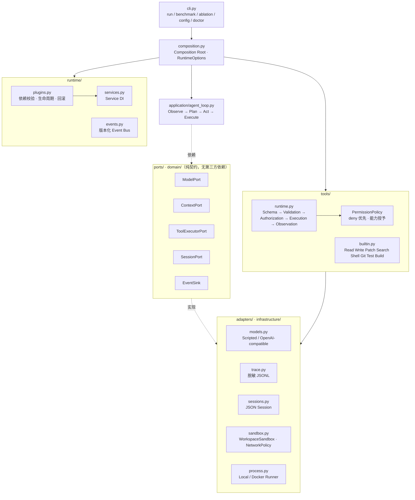
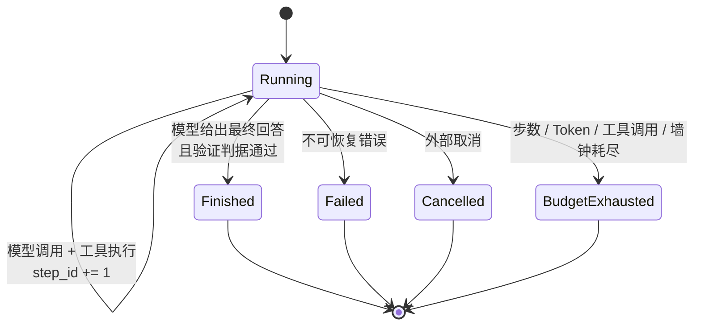

# Mini-dsh

Mini-dsh 是一个轻量级、可扩展、可评测的 Coding Agent Harness / Agent Runtime。它实现完整的 `Observe → Plan → Act → Execute → Observe → Continue | Finish`，重点研究在模型不变时，Context、工具反馈、反思、权限和执行隔离如何改变任务成功率与成本。

它不是一个新模型，也不是一个产品级 Coding Agent。它是一台**可替换、可观测、可复现**的 Harness：模型、工具、Context、Session、权限与事件总线全部走端口，核心 Loop 不依赖任何厂商 SDK、Shell 或文件系统细节，因此可以拿来做单变量消融实验。

- 版本：`0.1.0`（Apache-2.0）
- 运行时：Python `>=3.12`，依赖仅 `pydantic`，用 `uv` 管理
- 规模：31 个源码模块、12 个测试模块、131 个测试、29 个 Benchmark 任务

---

## Architecture



依赖方向单向收敛：`cli → composition → application → domain/ports → runtime/adapters`。`domain` 只有不可变 dataclass、`enum` 和 `Protocol`，不 import 任何 adapter；所有外部副作用（文件、进程、网络、Git）都必须穿过 Tool Runtime，模型与 Loop 不能直接触达。完整取舍见 [`docs/adr/0001-runtime-architecture.md`](docs/adr/0001-runtime-architecture.md)。

## Agent Loop



一次迭代的固定顺序：

```text
Observe  → ContextManager 依据策略构造视图（记录策略名、版本、Token 估算）
Plan     → ModelPort.complete(view) 返回回答或工具调用
Act      → 每个 tool_call 先经 Schema 校验，再经权限判断
Execute  → Tool Runtime 执行，产出结构化 Observation（状态/结果/耗时/截断/可重试）
Observe  → Observation 回灌 Context，失败以结构化事实返回而非吞异常
Continue → 未达终态且预算未耗尽则回到 Observe；否则进入唯一终态
```

不变量：每次运行唯一 `run_id`，每步单调递增 `step_id`；终态只有 `finished` / `failed` / `cancelled` / `budget_exhausted`；模型输出本身不产生副作用；重试只针对显式标记的瞬时错误且默认不重试有副作用的调用。

## 已实现能力

- 带 Step、Token、工具调用和墙钟预算的 Agent Loop，以及明确的终态。
- Model、Context、Tool、Event、Session 端口；插件依赖校验、生命周期回滚、Service DI 和热替换边界。
- Full History、Sliding Window、Summary Compaction、Repo Retrieval、Retrieval+Summary、Python Symbol Retrieval 六种 Context 策略，共用同一接口以支持公平消融。
- Read、Write、Patch、Search、Shell、Git、Test、Build 工具与统一 Schema/授权/超时/重试/Observation 流程。
- 工具输出大小上限、显式截断标记与 artifact 落盘（大输出不污染 Context）。
- 工作区路径与符号链接防逃逸、命令 deny/allowlist、环境过滤、敏感文件拒绝、进程组超时清理。
- 网络策略按 host / protocol / port 显式授权，默认全关。
- 可选 Docker hardened runner：只读根文件系统、capability drop、资源限制和默认断网。
- Scripted 与 OpenAI-compatible 模型适配器、JSON Session、脱敏 JSONL Trace。
- 隔离任务副本、可执行成功判据、指标汇总、成本核算和消融实验 API。
- 分层配置：CLI > `MINIDSH_*` 环境变量 > `minidsh.toml` > 安全默认值，并可打印每个字段的来源。

## 快速开始

需要 Git 和 [`uv`](https://docs.astral.sh/uv/)，Python 3.12 与依赖由 `uv` 自动管理：

```bash
uv sync --all-groups
uv run mini-dsh doctor
uv run pytest
```

无需 API Key 的最小端到端示例（临时工作区、脚本化模型、真实 Patch 与测试）：

```bash
uv run python examples/minimal_demo.py
```

输出示例：

```text
status: finished
steps: 4
tool calls: 3
tokens: 986
cost: $0.004110
```

## 运行 Coding Agent

Scripted provider 用于可复现实验：

```bash
uv run mini-dsh run "Fix the bug and run tests" \
  --workspace /path/to/repo \
  --script /path/to/responses.json \
  --allow-write \
  --allow-shell \
  --allow-command python \
  --test-command "python -m pytest"
```

OpenAI-compatible provider 只从显式配置读取凭据：

```bash
export MINIDSH_MODEL_ENDPOINT=https://provider.example/v1/chat/completions
export MINIDSH_MODEL=your-model
export MINIDSH_API_KEY=your-key

uv run mini-dsh run "Implement the requested change" \
  --provider openai-compatible \
  --workspace /path/to/repo \
  --context retrieval_summary \
  --allow-write
```

对不可信仓库启用 Docker 后端（需要宿主机已安装 Docker，生产环境应把镜像固定到 digest）：

```bash
uv run mini-dsh run "Fix the failing tests" \
  --provider openai-compatible \
  --workspace /path/to/repo \
  --allow-write \
  --allow-shell \
  --allow-command python \
  --sandbox-backend docker \
  --docker-image python:3.12-slim
```

默认只注册 Read、Search 和只读 Git；Write 与 Shell 必须逐次显式开启。Shell 中每个可执行文件还必须通过 `--allow-command` 或固定 test/build 命令加入 allowlist。运行结果输出最终回答、Git diff、指标及 Trace 路径。

## Benchmark 方法

一条命令跑完全部基线、消融与结果归档：

```bash
./scripts/run-all-experiments.sh          # 全部
./scripts/run-benchmark.sh core           # 单套基线
./scripts/run-ablation.sh stress context  # 单组消融
```

方法要点（完整协议见 [`docs/benchmark.md`](docs/benchmark.md)）：

1. **任务集固定**：每个任务声明 `repo_commit`、`seed`、`model`、`budget`、`isolation` 与成功判据 argv；manifest 与 fixture 全部入库，可离线复现。
2. **隔离副本**：Runner 为每个任务复制临时工作区，Agent 在副本上操作，互不污染。
3. **判据可执行**：成功与否由独立 `success_argv` 的退出码决定，从不采信模型自报完成。
4. **单变量消融**：`AblationRunner` 对同一 manifest 依次运行 `HarnessVariant`，只改一个变量（Context 策略 / 输出上限 / 重试与反馈粒度），模型、任务、预算与环境保持不变。
5. **事实优先**：每次 Model Call、Tool Call、权限决策、Context 变换与状态转换都发布版本化事件并落 JSONL Trace；原始 Trace 是事实源，摘要是可再生成视图。
6. **成本口径统一**：`ModelPricing` 显式给定 `input_usd_per_million` / `output_usd_per_million`，Token 由 Harness 侧确定性估算，报告给出每任务与总成本。

任务集规模：

| Suite | 任务数 | 覆盖 |
| --- | --- | --- |
| `smoke` | 1 | 端到端链路自检 |
| `core` | 25 | Bug Fix / Feature / Test Repair / Refactor / Code Understanding / Multi-file |
| `stress` | 3 | 长历史（18 步）、大输出（75 KB 日志）、被拒绝动作（越权 + 逃逸 + 密钥读取） |

## 实验结果

环境：`scripted` 模型（确定性，无网络）、seed `0`、定价 $3 / $15 per million tokens（输入 / 输出）。原始报告与 Trace 归档在 [`docs/results/`](docs/results/)，汇总见 [`docs/results/summary.json`](docs/results/summary.json)。

**基线**

| Suite | 任务 | 成功率 | 平均步数 | 平均 Token | 总成本 | 拒绝 | 拦截 |
| --- | --- | --- | --- | --- | --- | --- | --- |
| `smoke` | 1 | 100% | 4.00 | 208.0 | $0.001080 | 0 | 0 |
| `core` | 25 | 100% | 4.00 | 749.9 | $0.064545 | 0 | 0 |
| `stress` | 3 | 100% | 10.00 | 9534.0 | $0.095022 | 1 | 4 |

**Context 策略消融**（`stress`，只改 Context 策略）

| 策略 | 平均 Token | 总成本 | 成功率 |
| --- | --- | --- | --- |
| `sliding_window` | 8981.0 | $0.090045 | 100% |
| `summary_compaction` | 9233.7 | $0.092319 | 100% |
| `symbol_retrieval` | 9233.7 | $0.092319 | 100% |
| `full_history` | 9534.0 | $0.095022 | 100% |
| `retrieval_summary` | 12317.0 | $0.120069 | 100% |
| `repo_retrieval` | 12617.0 | $0.122769 | 100% |

**工具输出管理消融**（`stress`，只改输出上限与 artifact 落盘）

| 变体 | 平均 Token | 总成本 | 成功率 |
| --- | --- | --- | --- |
| `unbounded_output` | 32136.0 | $0.298440 | 100% |
| `bounded_output` | 9511.3 | $0.094818 | 100% |
| `bounded_output_artifact` | 9534.0 | $0.095022 | 100% |

**权限反馈与重试消融**（`stress`，只改重试策略与反馈粒度）

| 变体 | 平均 Token | 总成本 | 成功率 |
| --- | --- | --- | --- |
| `basic_feedback` | 8622.7 | $0.086820 | 100% |
| `no_retry` | 9534.0 | $0.095022 | 100% |
| `single_retry` | 9534.0 | $0.095022 | 100% |
| `detailed_feedback` | 9534.0 | $0.095022 | 100% |

**怎么读这些数**

- **Token 差异是可信的**：Harness 自己测量送入模型的 Context，脚本化响应不预置 Token 数；同一任务换策略即换输入。同一命令重复运行得到逐字节相同的读数。
- **成本差异直接跟随 Token**：`unbounded_output` 比 `bounded_output` 贵 3.38 倍，说明输出上限是成本杠杆而不是正确性杠杆。
- **检索类策略在长历史上更贵**：`repo_retrieval` 比 `sliding_window` 多 40% Token，因为它把相关文件重新注入 Context；`symbol_retrieval` 因为只切 AST 符号体，比 `repo_retrieval` 便宜 27%。
- **成功率恒为 100% 是设计使然**：脚本化模型保证步骤可预测，这一列校验的是 Harness 链路完整性（Patch 生效、判据可执行、状态机不误判），不是模型能力。要测能力必须换成真实 provider 并接受成功率波动。
- **`denied=1 / blocked=4`** 只在 `stress` 出现，正是 `stress-denied-action` 的设计意图：越权写入、`curl`、`rm -rf`、密钥读取与 `../` 逃逸都被策略层拦下并计入统计。
- **`core` 上 `tool_output` 消融无差异**（三个变体同为 749.9 Token）：该套件没有大输出任务，这组对照在 `core` 上不可分辨——这正是必须造 `stress` 套件的原因。

## 配置

优先级 `CLI > 环境变量 > minidsh.toml > 默认值`，可打印来源：

```bash
uv run mini-dsh config            # 打印生效值与每个字段的来源
MINIDSH_MAX_STEPS=20 uv run mini-dsh config
```

```toml
# minidsh.toml
[minidsh]
max_steps = 12
max_tokens = 200000
max_seconds = 120
allowed_tools = ["read_file", "search", "write_file"]
denied_tools = ["shell"]
```

## 工程命令

```bash
uv run ruff format --check .
uv run ruff check .
uv run mypy src tests
uv run pytest --cov=minidsh --cov-report=term-missing
```

四项全部为绿：70 个文件格式通过、ruff 无告警、`mypy --strict` 在 43 个源文件上无错误、131 个测试通过（覆盖率 83%，`runtime/` 为 100%）。CI 见 [`.github/workflows/ci.yml`](.github/workflows/ci.yml)。

## 文档

| 文档 | 内容 |
| --- | --- |
| [`AGENTS.md`](AGENTS.md) | 仓库级开发约束（12 节，含架构与依赖方向） |
| [`docs/benchmark.md`](docs/benchmark.md) | Manifest 格式、指标定义、消融协议与结果解读 |
| [`docs/context-engineering.md`](docs/context-engineering.md) | 六种 Context 策略的实现、成本与选型 |
| [`docs/sandbox-security.md`](docs/sandbox-security.md) | 威胁模型、六类攻击测试与已验证边界 |
| [`docs/technical-highlights.md`](docs/technical-highlights.md) | 技术亮点、5 个设计决策、SWE-bench 路线图 |
| [`docs/adr/`](docs/adr/) | 架构决策记录 |
| [`docs/results/`](docs/results/) | 实验报告与原始指标 |

## 安全边界声明

`local` Process Runner 是**策略层**（工作区、命令、环境、网络），不是容器或内核级隔离。允许执行通用解释器时，它仍可直接发起系统调用或网络访问。不可信模型与不可信仓库必须在外层容器或 VM 中运行并关闭网络；本地模式不宣称为恶意代码提供硬安全边界。详见 [`docs/adr/0002-security-model.md`](docs/adr/0002-security-model.md)。
