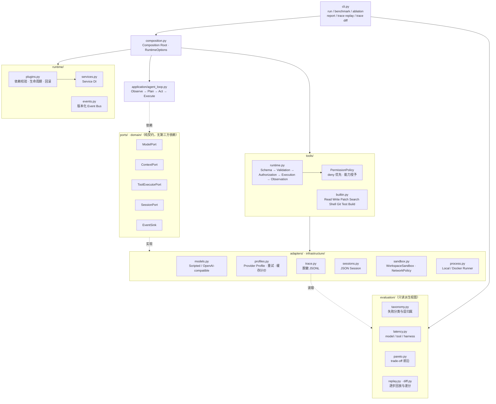
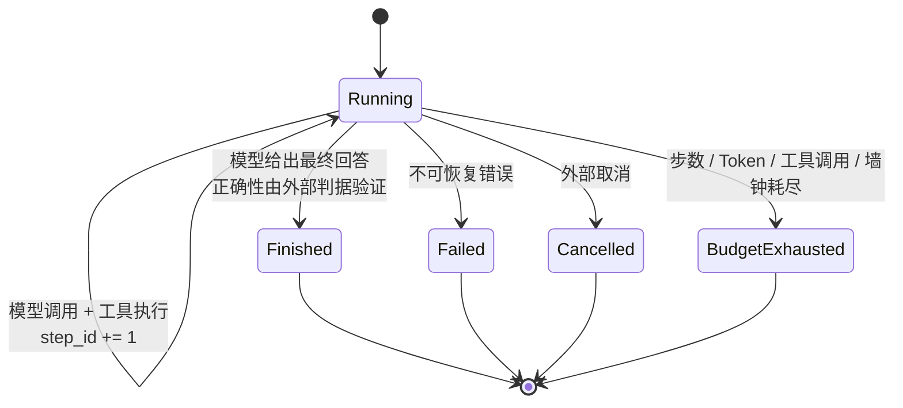

# Mini-dsh

Mini-dsh 是一个轻量级、可扩展、可评测的 Coding Agent Harness / Agent Runtime。它实现完整的 `Observe → Plan → Act → Execute → Observe → Continue | Finish`，重点研究在模型不变时，Context、工具反馈、反思、权限和执行隔离如何改变任务成功率与成本。

它不是一个新模型，也不是一个产品级 Coding Agent。它是一台**可替换、可观测、可复现**的 Harness：模型、工具、Context、Session、权限与事件总线全部走端口，核心 Loop 不依赖任何厂商 SDK、Shell 或文件系统细节，因此可以拿来做单变量消融实验。

- 版本：`0.3.2`（Apache-2.0）
- 运行时：Python `>=3.12`，依赖仅 `pydantic`，用 `uv` 管理
- 规模：51 个源码模块、23 个测试模块、337 个测试、35 个 Benchmark 任务（`core` 25 + `repo` 6 + `hard` 4）

> `0.2.0` 是 **Real-model evaluation release**：接入真实 provider profile、重复采样、成本与延迟分解、失败分类、Trace Replay / Diff 与 Pareto 分析。`0.3.0` 交付**第一批真实模型实测结果**：`repo` 套件在 `deepseek-flash` 上 18/18 通过、每次成功 $0.000937、Harness 自身占墙钟 0.26%，并修掉了接入时暴露的三个 provider 缺陷。`0.3.2` 补上此前所有套件都缺的东西——**判据**：`core` / `stress` / `repo` 都拿 Agent 能读能改的可见测试当判据，所以它们的 100% 测的是顺从而不是正确；`hard` 套件用留出判据（Agent 结束后才落地）第一次给出低于 100% 的成功率（**19/20**）。

---

## DSH 架构与 Harness 研究

项目同时保留可复现的 Harness 实验能力，并对齐 DSH 的核心设计：Session 消息
事件先提交、Context 从事件历史生成视图；Loop 通过工厂端口与插件服务替换；MCP
工具进入同一条 Schema、权限、超时和 Observation 链路。新增事件日志保留原有
Session 快照和 Trace 读取能力，历史评测报告仍代表当时的实现。

MCP 为可选依赖，当前通过 Python API 接入 Streamable HTTP 服务。Mini-dsh 是独立
Python Runtime，不直接兼容 Cordis/npm 插件。用法、实验控制与边界见
[DSH 对齐说明](docs/dsh-alignment.md) 和 [ADR 0012](docs/adr/0012-session-facts-loop-factory-mcp.md)。

## 本地 GUI

```bash
uv sync --dev
uv run mini-dsh gui --workspace .
```

自动打开深色双栏浏览器工作台：连续对话、停止任务、清空对话、按 Run ID 恢复、
查看 Git Diff、执行事件与本轮用量。对话与轨迹通过标签切换，运行设置和会话恢复
从侧边栏打开；视觉参考与范围见 [GUI 设计说明](docs/gui-design.md)。
模型沿用终端的 provider 配置（默认 DeepSeek）；
可在“运行设置”直接输入 API Key，或沿用服务端环境变量。页面提交的 Key 仅保存在服务进程内存，
不回显、不写入配置、Session 或 Trace，关闭服务后需重新输入。
设置中也可启用 Multi-Agent，选择子 Agent 数量和并发上限；协作结果以 Sub Agent 卡片展示。
运行期间不能修改设置，保存后保留当前对话。默认只读，显式授权写入或命令执行
使用已有 `--allow-write`、`--allow-shell` 和 `--allow-command` 参数。

无需模型服务的离线示例：

```bash
uv run mini-dsh gui --workspace . --script examples/gui_responses.json
```

`--no-open` 只打印地址，`--port 8765` 指定本地端口，`--resume RUN_ID` 启动时恢复。
请使用终端打印的完整地址打开（含本次服务的会话凭证）；刷新页面可继续连接。
服务仅监听 `127.0.0.1`，Ctrl+C 停止服务并取消当前任务。执行期间不能清空或恢复。
Trace 与 Session 存储在工作区 `.minidsh/` 内，GUI 是有界展示视图；事件按步骤更新，
暂不支持逐 Token 输出。`finished` 表示 Harness 运行结束，正确性仍以测试判据为准。
GUI 位于独立展示层，核心架构不变，见 [ADR 0008](docs/adr/0008-local-browser-gui.md)。

## Multi-Agent 协作

主 Agent 可通过 `delegate_sub_agents` 并行委派分析、检索和审查任务，Sub Agent 使用独立模型实例、上下文、运行 ID 和 Session，结果返回主 Agent 汇总。团队共用步数、Token、工具调用与墙钟预算，支持并发上限、累计子 Agent 上限和取消清理。

```bash
uv run mini-dsh chat --model-profile deepseek --multi-agent --subagent-max-parallel 2
uv run python examples/multi_agent.py  # 无 API Key 的临时工作区演示
```

子 Agent 首版只读，修改由主 Agent 统一执行。完整参数、Python API、Trace 回放与边界见 [Multi-Agent 文档](docs/multi-agent.md) 和 [ADR 0010](docs/adr/0010-sub-agent-collaboration.md)。

## Architecture



依赖方向单向收敛：`cli → composition → application → domain/ports → runtime/adapters`。`domain` 只有不可变 dataclass、`enum` 和 `Protocol`，不 import 任何 adapter；所有外部副作用（文件、进程、网络、Git）都必须穿过 Tool Runtime，模型与 Loop 不能直接触达。完整取舍见 [`docs/adr/0001-runtime-architecture.md`](docs/adr/0001-runtime-architecture.md)。

## Agent Loop



一次迭代的固定顺序：

```text
Observe  → ContextManager 依据策略构造视图（记录策略名、版本、Token 估算）
Plan     → ModelPort.complete(view) 返回回答或工具调用
Act      → 每个 tool_call 先经 Schema 校验，再经权限判断
Execute  → Tool Runtime 执行，产出结构化 Observation（状态/结果/耗时/截断/可重试）
Observe  → Observation 回灌 Context，失败以结构化事实返回而非吞异常
Continue → 未达终态且预算未耗尽则回到 Observe；否则进入唯一终态
```

不变量：每次运行唯一 `run_id`，每步单调递增 `step_id`；终态只有 `finished` / `failed` / `cancelled` / `budget_exhausted`；模型输出本身不产生副作用；重试只针对显式标记的瞬时错误且默认不重试有副作用的调用。

## 已实现能力

- 带 Step、Token、工具调用和墙钟预算的 Agent Loop，以及明确的终态。
- Model、Context、Tool、Event、Session 端口；插件依赖校验、生命周期回滚、Service DI 和热替换边界。
- Full History、Sliding Window、Summary Compaction、Repo Retrieval、Retrieval+Summary、Python Symbol Retrieval 六种 Context 策略，共用同一接口以支持公平消融。
- Read、Write、Patch、Search、Shell、Git、Test、Build 工具与统一 Schema/授权/超时/重试/Observation 流程。
- 工具输出大小上限、显式截断标记与 artifact 落盘（大输出不污染 Context）。
- 工作区路径与符号链接防逃逸、命令 deny/allowlist、环境过滤、敏感文件拒绝、进程组超时清理。
- 网络策略按 host / protocol / port 显式授权，默认全关。
- 可选 Docker hardened runner：只读根文件系统、capability drop、资源限制和默认断网。
- Scripted 与 OpenAI-compatible 模型适配器、JSON Session、脱敏 JSONL Trace。
- 隔离任务副本、可执行成功判据、指标汇总、成本核算和消融实验 API。
- 命名 Provider Profile（DeepSeek / OpenAI / Ollama）与带指数退避的瞬时错误重试；prompt cache 命中单独计价。
- 失败分类法：9 个类别归并成 `success` / `harness` / `agent` / `environment` 四层，每个诊断带证据链。
- 三层延迟分解（model / tool / harness）、cost per successful run、重复采样与 `pass@k`、Pareto trade-off 分析。
- Trace Replay（不调用模型，逐步重建 `Context → Model → Tool Call → Observation → State`）与 Trace Diff（定位两条 Trace 的第一个行为分叉点）。
- 分层配置：CLI > `MINIDSH_*` 环境变量 > `minidsh.toml` > 安全默认值，并可打印每个字段的来源。

## 快速开始

需要 Git 和 [`uv`](https://docs.astral.sh/uv/)，Python 3.12 与依赖由 `uv` 自动管理：

```bash
uv sync --all-groups
uv run mini-dsh doctor
uv run pytest
```

无需 API Key 的最小端到端示例（临时工作区、脚本化模型、真实 Patch 与测试）：

```bash
uv run python examples/minimal_demo.py
```

输出示例：

```text
status: finished
steps: 4
tool calls: 3
tokens: 986
cost: $0.004110
```

## 运行 Coding Agent

离线运行可显式指定 `--provider scripted`，该 CLI 参数优先于环境变量
`MINIDSH_MODEL_PROFILE`，不会因此选择真实 provider。若同时指定 `--model-profile`，
命令会报告配置冲突。

### 交互式终端会话

无参数启动会进入交互模式，默认使用现有 `deepseek` profile。凭据从
`DEEPSEEK_API_KEY` 读取；请先在终端设置该变量，再运行：

```bash
uv run --no-editable mini-dsh
```

可以连续输入任务和追问，模型会保留之前的回答、工具结果与修改记录。
每轮显示模型调用和工具执行进度、终态、Token 与耗时，自动保存 Session 和 JSONL Trace。
当前显示的是步骤进度和完整回答，不是逐 Token 流式输出。
每轮独立使用配置中的 Step / Token / 工具调用 / 墙钟预算。
未配置费率时交互模式允许调用模型，但成本显示为不可用，不把零费率当成实际成本。
需要成本核算时使用已有的 `--input-usd-per-million`、`--output-usd-per-million` 等参数。

默认只能读取仓库；需要修改代码、执行测试时显式授权：

```bash
uv run --no-editable mini-dsh chat \
  --allow-write --allow-shell --allow-command python \
  --test-command "python -m pytest"
```

| 命令 | 行为 |
| --- | --- |
| `/help` | 查看快捷命令 |
| `/status` | 查看模型、工作区、权限和上次 Run ID |
| `/diff` | 通过 Tool Runtime 查看 Git diff |
| `/clear` | 清空对话，保留已修改文件 |
| `/resume RUN_ID` | 恢复当前工作区中保存的对话 |
| `/exit` 或 Ctrl+D | 退出 |

Ctrl+C 中断当前任务并回到输入提示；在输入时按 Ctrl+C 清空输入。
行尾输入 `\` 可继续输入多行任务。取消不会回滚已完成的文件修改。
恢复会话也不会重放工具；没有记录结果的调用会作为“执行结果未知”进入下一轮，
要求模型先检查实际状态。原始 Trace 保持不变。
底层 provider 当前使用阻塞 HTTP adapter，取消后已经发出的请求可能继续至超时；
退出时 Python 会等待该后台请求释放。执行中的本地子进程仍由已有 runner 清理进程组。

也可以用 `--resume RUN_ID` 启动，或者通过 `--workspace`、`--model-profile`、
`--context` 等参数选择工作区和策略。没有 API Key 时仍可以进入界面查看帮助，
首次输入任务时会提示缺失的凭据。

`--no-editable` 避免依赖源码路径的 `.pth` 文件，适用于该文件被 macOS 标记为隐藏的环境。
修改源码后可运行 `uv sync --no-editable --reinstall-package mini-dsh` 重新安装。
开发和 CI 环境仍可使用原有的 editable 安装方式。

无网络、无 API Key 的可复现交互演示：

```bash
uv run --no-editable mini-dsh chat --script examples/chat_responses.json
```

依次输入两个问题即可看到回答与连续对话，再输入 `/exit` 退出。

Scripted provider 用于可复现实验：

```bash
uv run mini-dsh run "Fix the bug and run tests" \
  --workspace /path/to/repo \
  --script /path/to/responses.json \
  --allow-write \
  --allow-shell \
  --allow-command python \
  --test-command "python -m pytest"
```

OpenAI-compatible provider 通过命名 profile 选择；凭据只从 profile 声明的环境变量读取：

```bash
export DEEPSEEK_API_KEY=...

uv run mini-dsh run "Implement the requested change" \
  --provider openai-compatible \
  --model-profile deepseek \
  --model deepseek-flash \
  --workspace /path/to/repo \
  --context retrieval_summary \
  --input-usd-per-million 0.0 \
  --output-usd-per-million 0.0 \
  --allow-write
```

真实 provider 未声明价目时会拒绝运行，详见[真实模型评测](#真实模型评测)。

对不可信仓库启用 Docker 后端（需要宿主机已安装 Docker，生产环境应把镜像固定到 digest）：

```bash
uv run mini-dsh run "Fix the failing tests" \
  --provider openai-compatible \
  --workspace /path/to/repo \
  --allow-write \
  --allow-shell \
  --allow-command python \
  --sandbox-backend docker \
  --docker-image python:3.12-slim
```

默认只注册 Read、Search 和只读 Git；Write 与 Shell 必须逐次显式开启。Shell 中每个可执行文件还必须通过 `--allow-command` 或固定 test/build 命令加入 allowlist。运行结果输出最终回答、Git diff、指标及 Trace 路径。

## Benchmark 方法

一条命令跑完全部基线、消融与结果归档：

```bash
./scripts/run-all-experiments.sh          # 全部
./scripts/run-benchmark.sh core           # 单套基线
./scripts/run-ablation.sh stress context  # 单组消融
```

复现包含重复运行、Session 日志对照和 Trace 审计的完整离线基线：

```bash
uv sync --locked --all-groups
uv run python scripts/offline_regression.py
```

每次创建新的结果目录，记录实际提交号、工作区状态、源码及输入摘要；判据失败或
确定性指标漂移会非零退出。版本固定与审计口径见[可复现基线](docs/reproducible-baseline.md)。

方法要点（完整协议见 [`docs/benchmark.md`](docs/benchmark.md)）：

1. **任务集固定**：每个任务声明 `repo_commit`、`seed`、`model`、`budget`、`isolation` 与成功判据 argv；manifest 与 fixture 全部入库，可离线复现。
2. **隔离副本**：Runner 为每个任务复制临时工作区，Agent 在副本上操作，互不污染。
3. **判据可执行**：成功与否由独立 `success_argv` 的退出码决定，从不采信模型自报完成。
4. **单变量消融**：`AblationRunner` 对同一 manifest 依次运行 `HarnessVariant`，只改一个变量（Context 策略 / 输出上限 / 重试与反馈粒度），模型、任务、预算与环境保持不变。
5. **事实优先**：每次 Model Call、Tool Call、权限决策、Context 变换与状态转换都发布版本化事件并落 JSONL Trace；原始 Trace 是事实源，摘要是可再生成视图。
6. **成本口径统一**：`ModelPricing` 显式给定 `input_usd_per_million` / `output_usd_per_million`，Token 由 Harness 侧确定性估算，报告给出每任务与总成本。

任务集规模：

| Suite | 任务数 | 模型 | 覆盖 |
| --- | --- | --- | --- |
| `smoke` | 1 | scripted | 端到端链路自检 |
| `core` | 25 | scripted | Bug Fix / Feature / Test Repair / Refactor / Code Understanding / Multi-file |
| `stress` | 3 | scripted + **provider** | 长历史（18 步）、大输出（75 KB 日志）、被拒绝动作（越权 + 逃逸 + 密钥读取） |
| `repo` | 6 | **provider** | 跨文件 Bug Fix、定义+调用点契约、测试失败定位、新功能+测试、配置修改、多轮错误恢复 |
| `hard` | 4 | **provider** | 模块级规格实现：区间合并、令牌桶、分层配置、RFC 4180 解析 |

`repo` 套件没有 response script：每个任务至少跨两个模块，且其中几个 fixture 被刻意构造成"第一反应的那个改法会让另一个测试挂掉"，用来逼出多轮错误恢复而不是一次蒙对。生成脚本是 [`benchmarks/build_repo.py`](benchmarks/build_repo.py)。

`stress` 同时用于 scripted 与真实 provider 的消融：它的任务足够长，长历史与大输出两组变量才有区分度（`core` 上这两组对照被压平）。

### 留出判据（held-out verification）

`core`、`stress`、`repo` 都用**可见测试**当判据——而可见测试正是 Agent 能读、能改的那份文件。于是它们测的是"是否让可见测试变绿"，不是"是否符合规格"：一个把测试改绿但没实现契约的 Agent 拿满分。这正是它们全部饱和在 100% 的结构性原因。

`hard` 套件换掉了判据。任务在 manifest 里声明 `verification_overlay`，Runner 在 **Agent 结束之后、`success_argv` 执行之前**把该目录覆盖进工作区。时机是全部关键：

- 覆盖早了，判据就摆在 Agent 面前，可读可改；
- 覆盖晚了，判据不参与判定，等于装饰。

判据脚本 `run_verification.py` 本身也来自 overlay，所以它同样是 Agent 没见过的文件。它把发现范围钉死在 `verification_tests/`，并**断言收集到的用例数不低于声明值**——`unittest discover` 在空目录上退出码是 0，不设这条下限的话，"删掉测试目录"就是最省事的作弊方式。`verification_commit` 像 `repo_commit` 钉工作区一样钉住 overlay；声明了 overlay 却指不到目录的 manifest 会被直接拒绝，而不是静默退化成弱判据。

`hard` 的公平性是刻意设计的：**每个被留出检查覆盖的契约点都写在模块 docstring 里**，任务目标也明说"可见测试只是 smoke 子集，docstring 才是判据"。所以失败意味着"没有实现写明的契约"，而不是"被藏了需求"。`tests/test_hard_suite.py` 在离线、不调模型的前提下双向门禁每个任务：出厂 fixture 必须**失败**（否则任务一开始就是解好的），随包参考解必须**通过**（否则低成功率无法与"任务本身做不了"区分）。

## 实验结果

### scripted 基线（Harness 正确性）

环境：`scripted` 模型（确定性，无网络）、seed `0`、定价 $3 / $15 per million tokens（输入 / 输出）。原始报告与 Trace 归档在 [`docs/results/`](docs/results/)，汇总见 [`docs/results/summary.json`](docs/results/summary.json)。

**基线**

| Suite | 任务 | 成功率 | 平均步数 | 平均 Token | 总成本 | 拒绝 | 拦截 |
| --- | --- | --- | --- | --- | --- | --- | --- |
| `smoke` | 1 | 100% | 4.00 | 208.0 | $0.001080 | 0 | 0 |
| `core` | 25 | 100% | 4.00 | 749.9 | $0.064545 | 0 | 0 |
| `stress` | 3 | 100% | 10.00 | 9534.0 | $0.095022 | 1 | 4 |

**Context 策略消融**（`stress`，只改 Context 策略）

| 策略 | 平均 Token | 总成本 | 成功率 |
| --- | --- | --- | --- |
| `sliding_window` | 8981.0 | $0.090045 | 100% |
| `summary_compaction` | 9233.7 | $0.092319 | 100% |
| `symbol_retrieval` | 9233.7 | $0.092319 | 100% |
| `full_history` | 9534.0 | $0.095022 | 100% |
| `retrieval_summary` | 12317.0 | $0.120069 | 100% |
| `repo_retrieval` | 12617.0 | $0.122769 | 100% |

**工具输出管理消融**（`stress`，只改输出上限与 artifact 落盘）

| 变体 | 平均 Token | 总成本 | 成功率 |
| --- | --- | --- | --- |
| `unbounded_output` | 32136.0 | $0.298440 | 100% |
| `bounded_output` | 9511.3 | $0.094818 | 100% |
| `bounded_output_artifact` | 9534.0 | $0.095022 | 100% |

**权限反馈与重试消融**（`stress`，只改重试策略与反馈粒度）

| 变体 | 平均 Token | 总成本 | 成功率 |
| --- | --- | --- | --- |
| `basic_feedback` | 8622.7 | $0.086820 | 100% |
| `no_retry` | 9534.0 | $0.095022 | 100% |
| `single_retry` | 9534.0 | $0.095022 | 100% |
| `detailed_feedback` | 9534.0 | $0.095022 | 100% |

**怎么读这些数**

- **Token 差异是可信的**：Harness 自己测量送入模型的 Context，脚本化响应不预置 Token 数；同一任务换策略即换输入。同一命令重复运行得到逐字节相同的读数。
- **成本差异直接跟随 Token**：`unbounded_output` 比 `bounded_output` 贵 3.38 倍，说明输出上限是成本杠杆而不是正确性杠杆。
- **检索类策略在长历史上更贵**：`repo_retrieval` 比 `sliding_window` 多 40% Token，因为它把相关文件重新注入 Context；`symbol_retrieval` 因为只切 AST 符号体，比 `repo_retrieval` 便宜 27%。
- **成功率恒为 100% 是设计使然**：脚本化模型保证步骤可预测，这一列校验的是 Harness 链路完整性（Patch 生效、判据可执行、状态机不误判），不是模型能力。要测能力必须换成真实 provider 并接受成功率波动——真实 provider 下的实测见下一节。
- **`denied=1 / blocked=4`** 只在 `stress` 出现，正是 `stress-denied-action` 的设计意图：越权写入、`curl`、`rm -rf`、密钥读取与 `../` 逃逸都被策略层拦下并计入统计。
- **`core` 上 `tool_output` 消融无差异**（三个变体同为 749.9 Token）：该套件没有大输出任务，这组对照在 `core` 上不可分辨——这正是必须造 `stress` 套件的原因。
- **`stress-denied-action` 的 `denied=1 / blocked=4` 不会让它被归类为失败**：被拒绝的动作随后被合法工具绕过了，因此分类法把它判为 `success` 层。拒绝是"Harness 按规格工作"的证据，不是病因——这条规则见 [`docs/failure-taxonomy.md`](docs/failure-taxonomy.md)。

### 真实模型基线（`repo` 套件）

上面整张表都是 Harness 正确性的证据，不是模型能力的证据。下表是同一套 Harness 换成真实 provider 后的实测值。原始报告与 Trace 归档在 [`docs/results/repo-real.md`](docs/results/repo-real.md)，机器可读汇总见 [`docs/results/summary.json`](docs/results/summary.json) 的 `real_model` 块。

<!-- real-model-results:start -->
条件：`deepseek-flash` · thinking 关闭（`temperature_effective: true`，即 `temperature=0` 真正生效）· 每任务重复 3 次（逐任务交错采样）· off-peak 费率 $0.15 / $0.6 / $0.003 per 1M tokens（输入 / 输出 / 缓存命中）

| 指标 | 实测值 |
| --- | --- |
| 成功率 | 100%（18/18） |
| `pass@k` | 100% |
| 平均步数 | 6.61 |
| 平均 Token | 19,132 |
| 缓存输入占比 | 86% |
| 平均延迟 | 6,410.1 ms（model 6,290.6 / tool 103.1 / harness 16.4） |
| 总成本 | $0.016865 |
| 每次成功成本 | $0.000937 |
| 被拦截的危险动作 | 20 |
<!-- real-model-results:end -->

失败层分解是 `success 18 / harness 0 / agent 0 / environment 0`；`repeat_variance` 的成功率极差 `0.00`，Token 极差 15%。

**这个 100% 只说明这么多**：

- **样本极小，且不是独立评测。** 6 个任务 × 3 次 = 18 次运行；任务由写 Harness 的同一个人构造。它能排除的是"多轮工具循环根本跑不起来"这类整体性失败（见下一条），不能用来论证模型在真实仓库上的能力。
- **它顺带排除了一个真实的整体性失败**：DeepSeek 上游默认开启 thinking，而 thinking 模式下 API 会忽略 `temperature`、且要求历史 `reasoning_content` 原样回传（否则 400）。这个缺陷是第一次真实运行时才暴露的，修完之后 18 次运行全部通过。
- **三个与成功率无关、但只有真实 provider 才能测到的数字**：Harness 自身只占墙钟的 **0.26%**（16.4 ms / 6,410.1 ms），其余全是 provider 往返；**86% 的输入 Token 命中 prompt cache**，这是长上下文策略在生产中是否付得起的决定性数字；**每次成功成本 $0.000937**，比"更便宜但更容易失败"的变体更有决策价值。
- **20 次拦截全部是 `ls` / `find` 未进 allowlist**（本次只放行了 `python`）。按分类法它们落在 `success` 层：Agent 改用 `read_file` / `search` 绕过后仍然全部通过。这既实测了"拒绝可观测"，也说明这次运行里 Agent 少了它本来会伸手去拿的 shell 命令——一个诚实但可控的配置代价。
- **完整性检查**：18 条 Trace 里每次运行的写入都落在目标源码文件上（`shop/pricing.py`、`textkit/normalize.py` + `textkit/slugify.py` 等），**对任何测试文件的写入为 0**。成功率不是靠改测试拿到的。

### 真实模型消融（`stress` 套件）

scripted 消融能证明"策略之间有成本差异"，但**不能**证明"某个策略更准"——脚本化模型成功率恒为 100%，那一列没有区分度。把同一套消融换到真实 provider 上，第一次就暴露了一个 harness 缺陷（见本节末），修完之后才拿到可解释的对照。

报告归档在 [`docs/results/stress-real-context-ablation.md`](docs/results/stress-real-context-ablation.md) 与 [`docs/results/stress-real-tool_output-ablation.md`](docs/results/stress-real-tool_output-ablation.md)，机器可读汇总见 [`docs/results/summary.json`](docs/results/summary.json) 的 `real_model_ablations` 块。

<!-- real-model-ablation-results:start -->
条件：`deepseek-flash` · thinking 关闭 · 3 个 `stress` 任务 × 3 次重复 = 每变体 9 次运行 · off-peak 费率 $0.15 / $0.6 / $0.003 per 1M tokens（输入 / 输出 / 缓存命中）

**Context 策略消融**

| 变体 | 成功率 | 平均 Token | 平均步数 | 缓存占比 | 总成本 | 每次成功成本 |
| --- | --- | --- | --- | --- | --- | --- |
| `full_history` | 100% | 29,315 | 8.33 | 92% | $0.011553 | $0.001284 |
| `sliding_window` | 100% | 26,096 | 8.56 | 85% | $0.012579 | $0.001398 |
| `summary_compaction` | 100% | 26,073 | 8.22 | 83% | $0.013322 | $0.001480 |
| `repo_retrieval` | 100% | 17,767 | 6.56 | 80% | $0.011184 | $0.001243 |
| `retrieval_summary` | 100% | 16,747 | 6.33 | 75% | $0.011803 | $0.001311 |
| `symbol_retrieval` | 100% | 29,331 | 7.56 | 77% | $0.016193 | $0.001799 |

**工具输出消融**

| 变体 | 成功率 | 平均 Token | 总成本 | 每次成功成本 |
| --- | --- | --- | --- | --- |
| `unbounded_output`（上限 200K） | 100% | 32,687 | $0.011849 | $0.001317 |
| `bounded_output`（上限 20K） | 100% | 31,986 | $0.011743 | $0.001305 |
| `bounded_output_artifact`（上限 20K + 溢出落盘） | 100% | 30,523 | $0.011148 | $0.001239 |
<!-- real-model-ablation-results:end -->

**结论与限制**：

- **成功率仍然是 100%，所以这一列依然没有区分度。** Context 消融 6 变体 × 9 次 = 54 次、工具输出消融 3 × 9 = 27 次，全部通过，失败层分解全部是 `success 9`。`stress` 套件对 `deepseek-flash` 太容易——**这组实验只能得出成本结论，不能得出"某策略更准"的结论**，和 scripted 消融是同一个限制，只是现在发生在真实模型上。
- **Token 更少 ≠ 更便宜，在缓存计价下会反号。** `sliding_window`（26,096）与 `summary_compaction`（26,073）都比 `full_history`（29,315）省约 11% Token，但**都更贵**（$0.012579 / $0.013322 vs $0.011553）。机制是 prompt cache：命中价 $0.003 与未命中价 $0.15 相差 **50 倍**，而截断策略每一步都在改动前缀、把可复用前缀打断；`full_history` 只追加不修改，因此拿到最高的 92% 命中率。**这是"用 Token 数当成本代理"会系统性出错的地方。**
- **`repo_retrieval` 是成本赢家**（$0.011184，唯一在成本轴上不被支配的变体），步数也接近最少（6.56）：它在"多注入一点 Token"与"保住缓存前缀"之间取到了最好的平衡。
- **`retrieval_summary` 在 Token（16,747）、步数（6.33）、延迟（6,826 ms）三项上都是最少**，但成本高于 `repo_retrieval`——它的缓存命中率是六个里最低的 75%，因为摘要消息每步都要重算。
- **`symbol_retrieval` 最贵**（$0.016193）：Token 数与 `full_history` 几乎相同（29,331 vs 29,315），成本却高 40%，同样是缓存命中率只有 77%。
- **工具输出消融里真正有效的杠杆是落盘，不是上限。** `bounded_output_artifact` 在 Token、成本、步数三轴都不被支配：相比不设上限省 6.6% Token、5.9% 成本且成功率不变；而单把上限从 200K 压到 20K 只省 2.1%。
- **harness 自身开销 18.9–27.1 ms，占墙钟 0.2–0.4%**，六个 Context 变体一致，说明上表的差异不是 harness 侧造成的。

**这次消融是先修了一个 bug 才成立的。** 第一版跑出来四个变体成功率 0–22%，且全部记成 `provider_error`——而 `provider_error` 落在 `environment` 层，读起来就是"provider 挂了"。实际原因是截断型策略把一次工具调用回合从中间切开：保留了工具结果，却丢掉了声明它的那一轮 assistant 消息，provider 因此返回 400。**脚本模型不校验它收到的请求，所以这个缺陷在 deterministic 阶段结构性不可见**——deterministic 基线跑多少遍都照不出来。修复、回归测试与协议约束见 [`CHANGELOG.md`](CHANGELOG.md) 的 `0.3.1` 与 [`docs/context-engineering.md`](docs/context-engineering.md) §3.1；上表是修复后重跑的结果，修复前那版数字不作为 Context 结论。

### 留出判据套件（`hard`）：第一次测到能力

前面几张表的成功率都是 100%。这不是"模型很强"的证据，而是**判据的问题**：`core` / `stress` / `repo` 的判据都是工作区里的可见测试，也就是 Agent 能读、能改的那份文件。一个把测试改绿、却没实现契约的 Agent 同样拿满分——那些成功率测的是**顺从**，不是**正确**。

`hard` 换掉了判据（`verification_overlay`，见上文"留出判据"）。同一个模型、同一套 harness、同一档费率，**成功率第一次低于 100%**。报告归档在 [`docs/results/hard.md`](docs/results/hard.md)。

<!-- hard-suite-results:start -->
条件：`deepseek-flash` · thinking 关闭（`temperature_effective: true`）· 4 个 `hard` 任务 × 5 次重复 = 20 次运行 · off-peak 费率 $0.15 / $0.6 / $0.003 per 1M tokens（输入 / 输出 / 缓存命中）· 合计 **19/20**

| 任务 | 成功率 | 平均步数 | 平均 Token | 每次成功成本 |
| --- | --- | --- | --- | --- |
| `hard-config-precedence` | 100%（5/5） | 7.80 | 23,488 | $0.001579 |
| `hard-csv-records` | 100%（5/5） | 9.40 | 47,075 | $0.002607 |
| `hard-interval-merge` | 80%（4/5） | 9.20 | 56,818 | $0.003702 |
| `hard-token-bucket` | 100%（5/5） | 14.00 | 72,819 | $0.003085 |
<!-- hard-suite-results:end -->

其余指标：`pass@k` 100% · 平均 12.85 次工具调用 · 缓存输入占比 92.7% · 平均延迟 17,099.2 ms（model 16,911.1 / tool 156.2 / harness 32.0）· 总成本 $0.051163 · 每次成功成本 $0.002693 · 危险动作被拦截 34 次 · 权限拒绝 0 次 · 重试 0 次。

**结论与限制**：

- **唯一的失败是 Token 预算耗尽，不是做不出来。** `hard-interval-merge` 第 2 次重复：17 步（上限 24）、21 次工具调用（上限 48）**全部成功**，累计 151,854 Token 撞上 15 万 Token 上限。Trace 显示它一直在用自写的 `python -c` 探针反复验证（含随机化输入的性质检查），最后一步正要回到 `unittest` 复核时被截断。**绑定约束是 Token 而不是步数**——24 步的上限它只走到 17 步。
- **这一条落在 `harness` 层，但不能读成"模型没错"。** 失败层分解是 `success 19 / harness 1 / agent 0 / environment 0`。分类法里 `harness` 的含义是"运行时按规格执行了"（它确实按规格执行了预算），回答的是**运行时是否被免责**，而不是"模型是否失败"。按能力读，这就是一次**未收敛**。`agent: 0` 不等于"模型从未失败"——这层计数只说明没有任何一次失败可以归因到"harness 坏了"或"provider 挂了"。
- **四个任务里三个 5/5，只有 `hard-interval-merge` 有方差**（成功 spread 0.25、Token spread 64%）。也就是说这套任务目前区分的是**同一个任务内的采样波动**，还不足以给四个任务排出难度序。
- **最贵的任务不失败。** `hard-token-bucket` 是 Token（72,819）与步数（14.00）双料最高，却 5/5 全过——它只是慢。在这套任务上"贵"与"难"不是同一件事，这也再次说明 Token 数不是能力的代理量。
- **成本比 `repo` 高一个档：每次成功 $0.002693 vs $0.000937（2.9×）**，平均 Token 50,050 vs 19,132（2.6×）。这是应该的——`repo` 是修跨文件小 bug，`hard` 是实现整份模块规格。
- **34 次拦截里 31 次是 `find` 未进 allowlist**，3 次是绝对路径写入被沙箱拒绝。前者是诚实的配置代价（`hard` 与 `repo` 用同一份 `python` 单命令 allowlist，所以两次运行可比），后者是沙箱在按设计工作。

**这组结果不成立什么**：20 次运行只够让一个 5% 的失败率显现出来，不够给四个任务排序，也不够在 `hard` 上比较 Context 策略——`pass@k` 仍是 100%（每个任务至少成功过一次）。但**判据第一次不再饱和**，意味着"某策略更准"这类问题终于有了可以被测的量；在 `hard` 上重跑 Context 消融是自然的下一步。

## 真实模型评测

scripted 套件回答的是"Harness 是否按承诺工作"，不是"模型是否够好"。前者可以 100%，后者必须真实 provider 才能测。完整协议见 [`docs/real-model-evaluation.md`](docs/real-model-evaluation.md)。

**命名 Provider Profile**（pricing 故意不内置：官方价目会变，过期价目会静默污染报告里的每一个成本数字）：

| Profile | Endpoint | 凭据变量 | 价目 |
| --- | --- | --- | --- |
| `deepseek`（`deepseek-flash`） | `api.deepseek.com/chat/completions` | `DEEPSEEK_API_KEY` | 必须显式声明 |
| `deepseek-v4-pro` | `api.deepseek.com/chat/completions` | `DEEPSEEK_API_KEY` | 必须显式声明 |
| `openai` | `api.openai.com/v1/chat/completions` | `OPENAI_API_KEY` | 必须显式声明 |
| `ollama` | `127.0.0.1:11434/v1/chat/completions` | 无需 | 已声明为免费 |

**DeepSeek 的 thinking 默认被关掉**，这不是省事而是为了可复现：thinking 模式下 API 会**忽略 `temperature`**，所以开着它 `--temperature 0` 就形同虚设。要用 `--thinking` 显式打开，harness 会同时把 `reasoning_content` 在每次带 `tools` 的请求里回传（不回传 API 会直接返回 400）。

```bash
export DEEPSEEK_API_KEY=...

# 单任务 + 完整 Trace（thinking 关闭，temperature=0 真正生效）
uv run mini-dsh run "run the tests and fix the failure" \
  --workspace /path/to/repo --model-profile deepseek \
  --input-usd-per-million 0.15 --output-usd-per-million 0.6 \
  --cached-input-usd-per-million 0.003 \
  --allow-write --allow-shell --allow-command python --trace /tmp/run.jsonl

# 真实模型套件：每个任务重复 3 次（README 上那张表的来源）
uv run mini-dsh benchmark benchmarks/repo/manifest.json \
  --model-profile deepseek --repeat 3 \
  --input-usd-per-million 0.15 --output-usd-per-million 0.6 \
  --cached-input-usd-per-million 0.003 \
  --allow-write --allow-shell --verify-command python \
  --output benchmark-results/repo-real.json

# 留出判据套件：判据来自 overlay，Agent 在运行期间看不到
uv run mini-dsh benchmark benchmarks/hard/manifest.json \
  --model-profile deepseek --repeat 3 \
  --input-usd-per-million 0.15 --output-usd-per-million 0.6 \
  --cached-input-usd-per-million 0.003 \
  --allow-write --allow-shell --verify-command python \
  --output benchmark-results/hard.json

# 离线重渲染报告 + Pareto 分析，不重新调用模型
uv run mini-dsh report benchmark-results/repo-real.json

# 逐步回放 / 对比两条 Trace
uv run mini-dsh trace replay benchmark-results/repo-real-artifacts/traces/repo-cross-file-bug.jsonl
uv run mini-dsh trace diff traces/a.jsonl traces/b.jsonl --left-label full_history --right-label repo_retrieval
```

**报告会把自己的条件写进去。** 费率是 off-peak 的 $0.15 / $0.6 / $0.003 per 1M tokens；换一个时段或换一个模型，同一份报告里就会出现另一组成本数字，所以 `repo-real.json` 的 `model` 块记录 profile、endpoint、thinking 开关、`temperature_effective` 与显式费率，`docs/results/repo-real.md` 的 "Model and rate card" 章节把它们一并呈现。**归档要在重跑之前做**：报告与 Trace 是原地覆盖的，重跑一次就会冲掉上一次的原始产物。

一个真实 provider 如果没有声明价目，会**拒绝运行**而不是报告 `$0`：零价目和未声明价目无法区分，所以"是否已声明"被显式跟踪。本地权重（`ollama`）声明了免费价目因而通过；付费 provider 未声明则报错，`--allow-unpriced` 是显式的逃生口。

**成本模型**按每次 Model Call 计价，区分缓存与未缓存输入：

```text
cost = (billable_input × input_rate + cached_input × cached_rate + output × output_rate) / 1e6
billable_input = input_tokens − cached_input_tokens
```

比总成本更重要的两个派生量是 **cost per successful run**（`总成本 / 成功次数`，便宜但更容易失败的变体不是便宜）和 **cached input share**（决定长上下文策略在生产中是否付得起）。

**延迟模型**拆成三层，因为单一"平均延迟"在真实 provider 下被网络主导、对 Harness 作者毫无信息量：

| 分量 | 来源 | 含义 |
| --- | --- | --- |
| `model_ms` | `model_call_completed.duration_ms` 之和 | 等待 provider，含重试 |
| `tool_ms` | `tool_call_completed.duration_ms` 之和 | 子进程与文件系统 |
| `harness_ms` | `total_ms − model_ms − tool_ms` | Harness 自身开销（残差） |

## 失败分类

单一成功率把两个问题合并了。分类法把终态拆成 9 个类别、再归并成 4 个**层**，完整决策顺序见 [`docs/failure-taxonomy.md`](docs/failure-taxonomy.md)：

| 层 | 类别 | 读法 |
| --- | --- | --- |
| `success` | `none` | 跑完且判据通过 |
| `harness` | `permission_denied` `invalid_tool_call` `tool_error` `budget_exhausted` | **运行时按规格工作**：它正确地拒绝了或限制住了 Agent |
| `agent` | `model_reasoning_failure` `context_miss` `verification_failed` `loop_stuck` | Harness 没问题，模型仍然失败——这才是能力信号 |
| `environment` | `provider_error` | Provider 故障 |

`permission_denied` 是"Harness 正确"的**证据**而不是缺陷。报告只给层分解，不给一个混合的成功率。

**层回答的是"运行时是否被免责"，不是"模型是否失败"——这两问的答案可以相反。** `harness` 这一层里，`budget_exhausted` 尤其容易被误读：预算被按规格执行了，所以运行时免责，但一次跑到预算尽头的运行**按能力读就是一次未收敛**。`hard` 套件里唯一的失败正是这种情形（17/24 步、21 次工具调用全部成功、Token 撞顶），因此那份结果的 `agent: 0` **不能**读成"模型从未失败"，只能读成"没有任何失败可以归因到 harness 坏了或 provider 挂了"。逐类别的完整判读见 [`docs/failure-taxonomy.md`](docs/failure-taxonomy.md)。

## 配置

优先级 `CLI > 环境变量 > 已选方案 > minidsh.toml > 默认值`，可打印来源：

```bash
uv run mini-dsh config            # 打印生效值与每个字段的来源
MINIDSH_MAX_STEPS=20 uv run mini-dsh config
```

```toml
# minidsh.toml
[minidsh]
max_steps = 12
max_tokens = 200000
max_seconds = 120
enabled_tools = ["read_file", "search", "git"]
denied_tools = ["shell"]
```

可用 `[profiles.review]`、`[profiles.edit]` 等命名方案保存不同设定，再通过 `--profile` 或 `MINIDSH_PROFILE` 切换。CLI 支持 Context 窗口、系统提示词、反思、反馈详略、工具重试与输出策略，并可用 `--no-allow-write` / `--no-allow-shell` 撤销低优先级配置中的权限。

```bash
uv run mini-dsh config --config examples/profiles.toml --profile review
uv run python examples/custom_runtime.py
```

Python API 支持 `RuntimeComponents` 替换组件，以及 `plugin_runtime` 按服务名选择插件提供的模型、Context、Session、Journal、Loop 工厂、Permission、Event、执行器和工具。可关闭内置工具后使用自己的工具集；所有工具共享校验、授权和 Observation 链。详见 [自定义运行时与配置方案](docs/extensibility.md) 与 [DSH 对齐说明](docs/dsh-alignment.md)。

## 工程命令

```bash
uv run ruff format --check .
uv run ruff check .
uv run mypy src tests
uv run pytest --cov=minidsh --cov-report=term-missing
```

质量门禁为 `ruff format --check`、`ruff check`、`mypy --strict` 和完整 pytest；复现脚本另用
`uv run mypy src tests scripts/offline_regression.py` 检查类型。CI 见 [`.github/workflows/ci.yml`](.github/workflows/ci.yml)。

## 文档

| 文档 | 内容 |
| --- | --- |
| [`AGENTS.md`](AGENTS.md) | 仓库级开发约束（12 节，含架构与依赖方向） |
| [`docs/real-model-evaluation.md`](docs/real-model-evaluation.md) | Provider profile、成本与延迟模型、重复采样协议、数字来源说明 |
| [`docs/failure-taxonomy.md`](docs/failure-taxonomy.md) | 失败类别与层归属、决策顺序、Trace 回放/差分工作流 |
| [`docs/benchmark.md`](docs/benchmark.md) | Manifest 格式、指标定义、消融协议与结果解读 |
| [`docs/context-engineering.md`](docs/context-engineering.md) | 六种 Context 策略的实现、成本与选型 |
| [`docs/sandbox-security.md`](docs/sandbox-security.md) | 威胁模型、六类攻击测试与已验证边界 |
| [`docs/technical-highlights.md`](docs/technical-highlights.md) | 技术亮点、5 个设计决策、SWE-bench 路线图 |
| [`docs/adr/`](docs/adr/) | 架构决策记录 |
| [`docs/results/`](docs/results/) | 实验报告与原始指标 |

## 安全边界声明

`local` Process Runner 是**策略层**（工作区、命令、环境、网络），不是容器或内核级隔离。允许执行通用解释器时，它仍可直接发起系统调用或网络访问。不可信模型与不可信仓库必须在外层容器或 VM 中运行并关闭网络；本地模式不宣称为恶意代码提供硬安全边界。详见 [`docs/adr/0002-security-model.md`](docs/adr/0002-security-model.md)。
