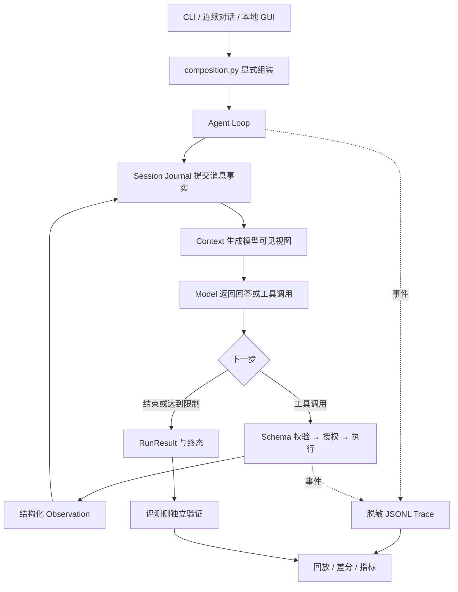

# Mini-dsh

Mini-dsh 是一个供自己在终端使用的 **Coding Agent Harness / Runtime**。
目标是在自己的仓库中持续对话，让模型读取代码、做局部修改、运行测试，并能继续追问、查看 diff 和恢复会话。
它把任务组织成 `Observe → Plan → Act → Execute → Observe → Continue | Finish`，
工具、权限、预算与执行记录为这条日常工作链路提供支持。

为了判断它是否值得自己使用，项目检查三个问题：**任务是否真的完成、执行是否满足约束、改变一个 Harness 机制是否有收益**。
模型、Context、工具、权限、Session 和事件通过显式接口组装，便于在固定条件下做对照。
项目不训练或微调模型；当前提供初步终端工作流，仍需在真实仓库上积累使用与验收记录。

- 版本：`0.3.2`（Apache-2.0）；本页能力与评测说明更新至 2026-10-28。
- 技术基线：Python `>=3.12`、`uv`、`src/` 布局；运行依赖包括 `pydantic`、流式 HTTP 的 `httpx` 和终端输入的 `prompt_toolkit`，MLX 与 MCP 为可选依赖。
- 规模：105 个源码模块、59 个测试模块、1001 个测试、35 个 Benchmark 任务（`core` 25 + `repo` 6 + `hard` 4）。测试数量由完整 pytest 收集核对，不代表功能验收充分。

轻量 DSH 扩展现已提供可取消的 OpenAI-compatible 流式输出、逐次审批、稳定会话及历史分叉、
配置驱动的 Python 插件组合、受控执行钩子和统一 local/Docker 文件与进程后端。
参照官方固定提交，实施范围、兼容边界和独立验收入口见[轻量 DSH Runtime](docs/mini-dsh-runtime.md)。

- 其他任务集：长历史/大输出 `stress`、26 个冻结的 `local_formal` 任务、12 道公开函数修复题，以及独立的 Harness 功能与机制实验。

**当前最重要的结果与边界**：公开修复子集 12/12 通过独立测试，但预算全部满足只有 10/12；
既有 Harness 策略实验 20/20 指定功能 case 通过，执行 20/24 次，候选通过 5/24，约束内成功 0/24。
Context 对照观察到输入 Token 减少约 39.1%，尚未证明任务成功率提升。
这些是各自冻结版本的历史记录，不补认成当前源码的完整验收。
本轮[轻量 DSH Runtime 验收](docs/results/mini-dsh-runtime-2026-10-13.md)执行 12 次真实模型场景，
专项判据通过 10/12，记录 64854 Token；发现的 Patch 预检分类问题已修复并通过离线回归。
修复后未重跑完整模型队列，GUI 人工使用与通用仓库成功率未测。

## 阅读导航

- [扩展升级执行与验收主计划 v1](docs/extension-roadmap.md)：后续升级的固定范围、四个 PR、验收矩阵与停止条件。
- [人工 Skills 与 Context](docs/extension-skills.md)：默认关闭、显式配置、按需加载与阶段验收边界。
- [项目 Memory](docs/extension-memory.md)：私有存储、运行外维护与生产组装，默认关闭；出关结论见 [PR 4 报告](docs/results/extension-pr4-2026-10-30.md)。
- [配对评测与 M5 门禁](docs/extension-evaluation.md)：固定 bootstrap、完整分母、Memory 机会与真实队列授权。
- [M5 本轮最终报告](docs/results/extension-m5-2026-10-30.md)：按原预算停止，80/90 行已核验、6 个产物通过；未执行行和预算超量保留，机制收益不可评估。
- [先在自己的终端里使用](#先在自己的终端里使用)
- [为什么做这个项目](#为什么做这个项目)
- [项目由什么组成](#项目由什么组成)
- [关键机制为什么这样设计](#关键机制为什么这样设计)
- [如何选择和计算评测指标](#如何选择和计算评测指标)
- [如何组织可信的评测](#如何组织可信的评测)
- [已有评测结果与结论边界](#已有评测结果与结论边界)
- [如何运行与复核](#如何运行与复核)
- [配置与扩展](#配置与扩展)
- [当前限制与后续工作](#当前限制与后续工作)
- [工程门禁与文档](#工程门禁与文档)

## 先在自己的终端里使用

要在本仓库一次启用全部编码工具及 Skills、Verification、Project Memory：

```bash
uv sync --locked --all-groups
uv run mini-dsh-work
```

需要运行 Docker Desktop。首次启动自动构建开发镜像（需要下载依赖），随后
复用镜像；依赖变更后使用 `uv run mini-dsh-work --rebuild-image`。
`uv run mini-dsh-work --check` 只准备并检查配置，不调用模型。
启动后 `/tools` 查看 13 项工具，写入和命令仍逐次审批，执行容器禁网。
固定测试为 `uv run --no-sync pytest -q`，固定构建为 `uv build --no-build-isolation`；
三个人工 Skills 来自 `examples/skills`。Memory 明确绑定 mini_dsh/work_v1，
默认在仓库父目录 `.mini-dsh-private/mini_dsh`，可用 `--memory-root /absolute/private/path`
指定；没有证据与操作者批准时，候选不会进入后续 Context。
此入口用于 Mini-dsh 自身开发，模型使用原有 Key 配置，支持透传 `--model-profile`
等 work 参数。范围及限制见 [ADR 0027](docs/adr/0027-full-work-startup.md)。

在本项目目录安装依赖并启动：

```bash
uv sync --locked --all-groups
uv run mini-dsh work --test-command "uv run pytest"
```

也可以直接裸启动，效果等价于 `work`：

```bash
uv run mini-dsh --test-command "uv run pytest"
```

如果希望在任何目录直接输入 `mini-dsh` 启动，把本仓库安装为全局工具：

```bash
uv tool install --editable /absolute/path/to/mini-dsh
cd /absolute/path/to/any/project
mini-dsh
```

全局命令按当前目录解析工作区并读取该目录的配置；依赖或入口变更后重新执行
安装命令。`mini-dsh-work` 仅用于 Mini-dsh 自身开发，不替代普通项目的 `mini-dsh`。

`work` 默认使用 DeepSeek profile。启动时读取 API Key，优先级为：显式环境变量 >
工作区 `.minidsh/credentials.toml` > 全局 `~/.config/minidsh/credentials.toml`。
工作区可按 provider 覆盖全局 Key；没有工作区配置时直接使用全局默认值，不复制 Key。
`MINIDSH_CONFIG_HOME` 可指定全局配置目录，必须是绝对路径。
密钥配置与普通 `minidsh.toml` 运行参数分开，文件格式相同：

```toml
[credentials]
DEEPSEEK_API_KEY = "your-provider-key"
# 使用其他 profile 时填写其 API Key 环境变量名，例如 OPENAI_API_KEY。
```

首次提交模型任务时如果没有 Key，会隐藏输入并保存到工作区的密钥文件，随后继续
执行该任务；下次启动直接复用。`/key` 可主动输入或更新工作区 Key。
`/status` 显示 Key 来源，不显示内容；`/test`、`/diff`、`/tools` 无需模型凭据。
取消输入会回到提示符，不能隐藏输入时拒绝明文回退。保存失败会明确提示，Key 仍可
用于本次会话，但不会宣称下次可复用。手动 `/key` 更新在当前进程优先，下次启动仍
遵循环境变量优先的规则。

保存使用独立的 Tool Runtime 权限与原子替换，文件权限为 `0600`；保留同文件中其他
provider 的 Key，并将 `/.minidsh/credentials.toml` 加到项目 `.gitignore`。
忽略规则不会自动移除已跟踪的文件。Key 以本地明文配置保存，不进入 Prompt、Session、
Trace 或终端历史；模型文件工具和 Context 检索禁止读取该密钥文件，包括符号链接别名。
本地模式中显式授权的 Shell/外部程序仍受已有隔离边界限制，不能据此宣称操作系统级
Secret 隔离。GUI 读取相同的配置，但页面临时提交的 Key 仍只用于会话内存。
配置与验收细节见 [分层密钥配置 ADR](docs/adr/0021-layered-credentials.md)。

```text
you > 修复失败测试，保持公共接口不变，说明修改和验证结果。
you > 这个修改对边界情况有什么影响？
you > /diff
you > /test
you > /exit
```

`work` 明确选择一个允许工作区编辑的配置：提供文件定位、局部读取、Patch、新文件写入
和 `shell` 工具。shell 默认只允许常用开发命令（`git`、`uv`、`python`、`python3`、
`pytest`、`ruff`、`mypy`），每次调用仍需终端审批；`--no-allow-shell` 可关闭，
其他程序用 `--allow-command` 显式列出。模型不能修改 `test` 工具的命令参数。
已有 CLI、环境变量或配置中的显式权限限制继续优先，例如 `--no-allow-write`。
输入 `/tools` 可查看工具列表、执行后端和命令授权，无需模型凭据。
本地后端的命令运行在启动 Mini-dsh 的同一台机器上；工作区限制不代表远程执行。
例如需要查找并停止本机开发服务器时，启动时显式授予对应程序：

```bash
uv run mini-dsh work --workspace /absolute/path/to/website \
  --allow-command git --allow-command uv \
  --allow-command lsof --allow-command ps --allow-command kill
```

随后可输入“关闭 8001 端口的开发服务器，先确认进程身份，关闭后复查端口”。
这些授权在整个会话有效；`kill` 白名单允许调用该程序，并非仅限某个端口或 PID。
模型提示要求行动请求调用可用工具并验证结果；缺少工具时说明具体授权限制，
不把缺少 `shell` 误说成无法访问本机。真实模型是否按此执行仍需实际使用验收。

同一个入口也可以先讨论方案：默认提示要求大纲、解释和讨论按最新请求直接回答，
围绕具体产品给出内容，不自动扩展成完整工程脚手架。`work` 默认关闭固定的 Local-first
编辑计划；需要该机制时显式加 `--local-first`。这些属于模型行为指引，工具权限仍是执行边界。
`work` 的默认表达按终端使用设计：日常操作用一到三句说明结果、验证和阻碍，
省略装饰性标题、重复工具日志和泛泛的后续邀请；明确要求大纲或详细解释时按需要展开。
输出层不裁剪模型正文；自定义系统提示优先，风格是否遵循仍取决于实际模型响应。

每轮开始经 Tool Runtime 读取根 `AGENTS.md` 和有限文件清单，计入工具预算与 Trace。
根说明可选，缺失会显示正常缺省提示；权限或路径违规仍显示失败并保留原始 Observation。
真实终端使用可编辑输入框：Enter 发送，Alt+Enter 换行（也可先按 Escape 再按 Enter），
左右键移动光标、上下键浏览历史，Tab 补全命令；多行粘贴保留为一份草稿，按 Enter 后发送。
输入历史仅保存在进程内存；`/key` 与首次配置的隐藏输入不进入该历史。
终端显示工具进度与回答，工具完成行附带工具 Observation 的真实耗时，省略每次模型调用的 `Thinking…` 提示；模型调用事件继续记录在 Trace 中。
输入框底部状态栏显示模型、工作区、权限和上一轮结果；Tab 补全会列出匹配命令及说明。
重定向/管道或 `TERM=dumb` 保留普通行输入与反斜杠续行，并用 `Request:` 回显核对收到的文本。
终端输入设计与验收见 [输入编辑器 ADR](docs/adr/0020-terminal-input-editor.md)。
默认 BudgetContext 保留最新用户任务、根说明和最近的运行状态；嵌套说明由模型按提示继续读取。
终端列出修改文件和真实测试状态：非零退出码显示失败，测试后继续改文件会显示需重新验证。
测试通过只代表配置的命令返回成功，测试充分性与最终任务正确性仍需你审核。

常用命令：`/help`、`/status`、`/tools`、`/diff`、`/test`、`/key`、`/clear`、`/resume RUN_ID`、`/exit`。
每轮输出 Run ID，重启后可以用：

```bash
uv run mini-dsh work --test-command "uv run pytest" --resume RUN_ID
```

用于其他仓库时，指定 `--workspace /absolute/path/to/repo` 并传入那个项目的测试命令。
`/test` 结果保留在当前对话中，在下一轮任务保存时随历史落盘；立即退出不会创建可恢复的独立测试会话。
`chat` 继续默认只读。支持流式模型时展示增量文本；根说明超出读取/输出上限会停止，需先缩短说明；
本地命令执行不是操作系统级隔离，适用于自己信任的项目。

这条路径已用离线模型在临时仓库验证读取、修改、真实测试与连续追问；
本次代码修改没有重新调用真实模型，尚不能据此给出新版本的真实任务成功率。
设计与验收范围见 [终端工作配置 ADR](docs/adr/0019-personal-terminal-workflow.md)。

## 为什么做这个项目

首先，我需要一个能自己用的编码工作流：进入仓库、提出任务、检查修改、运行测试、继续追问。
工具定位、项目约束、测试反馈和会话恢复直接决定这条工作流是否顺手。
评测用于发现这些环节的缺口，再判断改动是否真的有帮助。

编码 Agent 的最终回答不能说明代码正确；测试变绿也可能只是可见测试被修改。
一次失败可能来自模型判断、上下文缺失、工具错误、权限拒绝或预算耗尽。
如果只给一个成功率，就无法判断应该改模型、改运行机制，还是修评测器。

Mini-dsh 把这些问题拆开：

| 要解决的问题 | 为什么单看最终回答不够 | 项目怎么做 |
| --- | --- | --- |
| 判断任务正确性 | 模型自报完成与测试输出可能不可靠 | 捕获候选，使用模型不可访问的独立判据验证；保留验证结果 |
| 解释执行过程 | 最终 diff 看不到模型当时收到什么、为何停下 | 记录 Context、模型响应、工具、权限和终态；支持 Trace Replay / Diff |
| 检验设计收益 | 换模型、任务和预算后，差异无法归因 | 固定协议，按任务和重复编号配对，每次只改变指定机制 |
| 控制执行条件 | 模型输出不能直接获得文件或进程权限 | 工具统一校验和授权；默认只读；不可信执行使用隔离环境 |
| 控制资源消耗 | 长历史、大日志和重复失败会持续消耗预算 | 四类运行预算、工具输出上限、Context 策略及可选 Loop Guard |

可替换接口服务于实验控制；回放服务于诊断；独立验证服务于结果判断。
证据保存提高可核查性，但不能自行证明机制提高长程推理质量，也不能消除选题偏差。

## 项目由什么组成

### 一次任务的执行路径



基本 Loop 的 Plan 阶段由模型决策承担，并非独立通用规划器。
Local-first 模式另有轻量 Plan State。独立验证由 Benchmark 侧执行，普通交互中的 `finished`
只表示 Loop 正常结束，不保证任务正确。

### 模块、职责与设计理由

| 模块 | 是什么 | 为什么需要 | 怎么做 |
| --- | --- | --- | --- |
| `domain/`、`ports/` | 共享值对象与能力接口 | 核心流程需要摆脱厂商和平台细节 | dataclass、enum、Protocol 定义请求、响应、Observation、预算、事件和端口 |
| `application/` | 单 Agent 执行编排 | 状态与预算不能散落在工具或 UI 中 | 显式注入模型、Context、工具、事件和 Session；结构化处理失败与终止 |
| `composition.py` | 组合根 | 避免隐藏全局依赖，方便替换实验变量 | 根据 RuntimeOptions 与 RuntimeComponents 组装实现，支持 Loop 工厂 |
| `config.py` | 分层配置解析 | CLI、环境变量和配置文件不能各有一套默认值 | 按 CLI > 环境变量 > 配置文件 > 安全默认值合并，记录生效字段的来源 |
| `configured_runtime.py` | 配置与插件驱动的组装 | 让入口选择已安装组件，同时保持信任边界 | 稳定插件 ID、显式信任、首次操作时启动、失败与退出时逆序释放 |
| `context/` | 历史裁剪与仓库信息视图 | 全量历史会增长，裁剪又可能丢信息 | 统一 ContextView，记录策略、版本、估算 Token、遗漏数量和策略元数据 |
| `tools/` | 工具注册、执行与反馈 | 模型参数需要校验，工具失败需要回灌 | Pydantic 边界校验、权限决策、超时、有限重试、统一 Observation |
| `infrastructure/` | 文件、进程和容器适配 | 真正的执行与隔离依赖操作系统 | 路径检查、原子写入、argv 子进程、本地/Docker runner；公共评测使用独立容器 |
| `runtime/` | 插件、服务注册与事件总线 | 扩展需要依赖与资源生命周期管理 | 检查重复服务、缺失依赖与环；按序启动、逆序清理；隔离订阅者异常 |
| `adapters/` | 模型、Session、Trace、MCP 实现 | 外部协议差异不应进入核心 Loop | Scripted、OpenAI-compatible、可选 MLX；JSON Session、JSONL Journal/Trace |
| `benchmark/` | 固定任务和实验执行 | 公平比较需要固定输入、环境与判据 | manifest、隔离副本、留出验证、重复采样、冻结实验与逐次结果保存 |
| `evaluation/` | 只读派生分析 | 汇总分数需要可追溯到原始事实 | Trace Replay/Diff、失败分类、延迟拆解、证据 sidecar 与指标聚合 |
| `cli.py`、`interactive.py`、`terminal.py`、`gui/` | 使用入口 | 让开发者实际执行、查看和恢复任务 | 复用同一运行时；`terminal.py` 只负责输入编辑与历史，GUI 为本机展示层，提供对话、事件和 diff |
| `collaboration.py` | 可选子 Agent 编排 | 分析与审查可以并行，但不能扩大权限 | 独立子上下文与模型实例、团队共享预算；子 Agent 只读，主 Agent 统一修改 |

核心 Loop 依赖端口，具体实现由组合根选择。GUI 与协作在扩展层；相关边界变更记录在
[GUI ADR](docs/adr/0008-local-browser-gui.md) 和 [协作 ADR](docs/adr/0010-sub-agent-collaboration.md)。
这些模块的存在不构成机制收益证据，仍需按任务验收。

## 关键机制为什么这样设计

### Agent Loop：把终止与失败变成明确状态

每次运行有唯一 `run_id`，每步 `step_id` 单调递增。Loop 构造 Context，调用模型，
把工具请求交给 Tool Runtime，将 Observation 提交到历史后继续。终态只有
`finished`、`failed`、`cancelled`、`budget_exhausted`。

四类预算分别限制步骤、Token、工具调用和墙钟时间。Token 用量通常在模型返回后才能确定，
因此可能出现单次在途超量：全部计入实际消耗，达到额度后停止后续调用与动作。
这是一种可观测的停止策略，不能宣称实际 Token 永远不越过名义额度。
模型失败携带已报告用量；未知用量单独记录。契约见[失败用量记录](docs/model-failure-accounting.md)。

Local-first 可启用轻量 Plan State、错误反馈和 RepetitionGuard：三次等价重复触发恢复提示，
六次触发停止。它帮助限制重复执行，但提示是否促成有效恢复，要由故障事件与检查点验证。

### Context：保留事实，比较不同的信息选择方式

Session Journal 先提交消息事实，Context 再从历史构造模型可见视图；运行事件进入 Trace。
Session 快照用于恢复，Trace 用于过程审计，摘要和指标都是派生视图。
压缩不能反向覆盖已保存历史，恢复也不自动重放工具副作用。

| CLI 策略 | 方式 | 为什么提供 | 主要代价或边界 |
| --- | --- | --- | --- |
| `full` | 保留完整历史 | 提供信息完整的基线 | 历史和输入量随执行增长 |
| `sliding` | 固定前两条消息与近期完整工具回合 | 控制近期历史长度 | 中段信息可能丢失 |
| `summary` | 确定性文本压缩与近期历史 | 检验压缩对执行和输入量的影响 | 有损摘要；不是模型生成的语义记忆 |
| `retrieval` | Full History 加词面仓库检索 | 检验代码注入是否改善定位 | 注入本身增加输入，词面匹配可能遗漏 |
| `retrieval_summary` | 摘要加仓库检索 | 组合历史压缩与代码补充 | 两种机制的代价同时存在 |
| `symbol` | 摘要加 Python AST 符号检索 | 注入函数/类片段而非整文件 | 仅覆盖 Python，基于符号名匹配 |
| `budget` | 按输入预算选择消息和完整工具回合 | 优先保留关键状态，显式控制视图大小 | 关键状态本身超过预算时失败；估算不等于实际 API 用量 |

窗口不能切开 assistant 工具声明与对应 tool 结果，否则外部模型协议可能拒绝请求。
BudgetContext 显式固定关键决策及最新 Plan State、未解决错误、修改文件状态。
其他裁剪策略主要保留固定前缀与近期历史，不能宣称具有同等关键事实保留保证。
MLX 可使用自身 tokenizer 计数，其他默认路径主要采用字符启发式估算。
策略及取舍见[Context 文档](docs/context-engineering.md)。

### Tool Runtime：统一检查和反馈，而不是直接执行模型文本

工具调用经过 `Schema → Call → Validation → Authorization → Execution → Observation`。
工具声明名称、版本、输入 Schema、超时、副作用和权限需求。未知工具、无效参数、权限拒绝、
执行失败与超时分别产出结构化状态，不能只打印日志。

写入优先支持带 `expected` 文本校验的 Patch，文件修改采用原子替换。
Shell 用 argv 数组执行，不把模型字符串直接拼入 shell。
只读、明确可重试的失败允许有上限的重试；有副作用的工具默认不自动重试。
支持 Patch 不等于已证明修改最小，当前没有统一的改动范围最小化验收。

工具输出默认上限为 20,000 字符；超限 Observation 显式标记截断，可将原始输出保存到
`.minidsh/artifacts/`，并保留预览与诊断。完整输出不自动重新注入 Context。
截断既可能减少输入，也可能让模型多走几步，因此收益要同时看任务成功与总消耗。

### 权限与隔离：分别说明策略检查和硬边界

默认只读；写文件和执行命令需显式授权。工具权限 deny 优先，命令需要 allowlist；
文件工具规范化真实路径，拒绝工作区逃逸与常见敏感文件。子进程环境采用 allowlist。
网络策略显式描述 host/protocol/port，Trace 与 Session 做脱敏。

本地 Runner 是策略层，允许 Python 等通用解释器后，无法阻止解释器内部自行访问系统或网络。
Docker Runner 提供默认断网、只读根文件系统、capability drop、禁止提权和资源限制。
公共评测进一步把候选与验证放进独立、无主机挂载和密钥的容器。
安全测试要观察真实副作用，模拟 adapter 通过不能代替实际隔离验收。
详细限制见[安全文档](docs/sandbox-security.md)和[安全 ADR](docs/adr/0002-security-model.md)。

### 评测与回放：保存证据，再判断结论

Trace 使用带 `schema_version` 的 JSONL，包含运行/步骤 ID、UTC 时间和单调时钟耗时。
Replay 从已记录的事件重建步骤摘要，不调用模型，也不重执行当时的工作区。
Diff 对齐两条 Trace，定位首次行为分叉；分叉有助于诊断，但本身不能证明因果。

Trace 能告诉我们工具失败、预算和用量；“工具选得对”“确实恢复”“没有泄漏”等语义结论
还需要独立检查。评分 sidecar 绑定 `run_id`，保存 `case_id`、判据来源和检查结果。
指标由事实派生，缺少证据保持未知。当前没有自动从任意失败 Trace 提炼可检索专家 Skill 的闭环。

## 如何选择和计算评测指标

### 先声明主张，再确定主指标

Mini-dsh 分别评估最终任务、执行约束与机制收益，不用单个加权总分替代关键正确性或安全验收。

| 主张 | 优先指标 | 为什么选它 | 如何检查 |
| --- | --- | --- | --- |
| 能完成任务 | `task_success_rate` | 模型自报与 `finished` 不能说明正确 | 独立测试/规格判据；同时报告完整任务清单、已验证量和覆盖率 |
| 在约束内完成 | 任务通过与全部声明约束的交集 | 正确修复也可能超预算或违反要求 | 独立验证与预算/专项约束证据联合检查；未检查项不能推定满足 |
| 消耗是否合理 | `total_tokens`、每次成功 Token、延迟 | 少 Token 可能只是更早失败 | 包含失败消耗，和成功率一起比较 |
| 机制是否有用 | 配对成功差值、Token/步骤差值、恢复率 | 单组成绩不能解释改进来源 | 同任务、同模型、同预算、单变量对照，先验证机制触发 |
| 安全是否成立 | 拦截率、误拦截率、泄漏与违规检查 | 拒绝次数不等于正确拦截 | 固定禁止/允许探针，检查文件、进程、网络和输出副作用 |

“约束内成功”是按该实验预声明的任务、预算和其他要求组合判定。
最新 Harness study 另要求正常完成及组别判据，旧公开题派生指标只覆盖四类预算；
不同协议的这个交集不能混为同一个通用分数。

### 结果、过程与资源指标的口径

| 指标 | 分子 / 分母或计算方法 | 解释边界 |
| --- | --- | --- |
| `task_success_rate` | 独立验证通过 / 已验证运行 | 另报告通过 / 完整预声明集合；失败、取消、预算终止与未运行项保留在清单中 |
| `goal_completion_rate` / `partial_success_rate` | 预声明子目标完成量 / 已检查量；部分成功按固定子目标判断 | 不能把部分完成推定为完整成功 |
| `constraint_satisfaction` | 满足的约束条目 / 已检查条目 | 逐条满足比例与全部约束满足的运行比例不同 |
| `constraint_satisfied_run_rate` | 全部声明约束满足 / 能判定的运行 | 本轮检查预算不等于已检查全部安全与业务约束 |
| `tool_error_rate` | 执行失败、超时或非零退出 / 已执行完成调用 | 预期的失败测试也在其中；不是 Harness 缺陷率 |
| `invalid_tool_call_rate` / `permission_denied_rate` | 未知工具/无效参数、权限拒绝分别统计 | 参数有效不等于工具选择正确；拒绝比例不是安全拦截率 |
| `tool_call_accuracy` | 工具选择和参数符合专项判据 / 已检查选择 | 必须有独立预期标签，不能只看 Schema |
| `repeated_failed_action_rate` | 相邻同工具、同参数、同失败类型重复 / 可观察调用 | 保守代理指标；成功重复读取和正常复测不计为失败重复 |
| `recovery_rate` / `retry_recovery_rate` | 故障事件恢复、自动重试恢复分别统计 | 恢复需预定义事件、期限和检查点；不能仅凭后来某次成功 |
| `avg_steps` / `avg_tool_calls` | 已执行运行的平均步数 / 调用数，附样本数 | 刺激步骤是否计入需声明；提前失败可能降低平均值 |
| `latency_p50_ms` / `latency_p95_ms` | Loop 总耗时的线性插值分位数，附样本数 | 不含环境准备与独立验证；小样本 P95 不说明稳定尾延迟 |
| `total_tokens` / `unknown_usage_calls` | 已报告输入 + 输出；未知调用单独计数 | 包含失败与在途超额；未知不能记成零消耗 |
| `cache_hit_rate` / `cached_input_share` | 命中调用 / 有缓存读数调用；缓存输入 / 对应输入 | 两种比例不同，缓存输入是输入子集，不重复加入总量 |
| `unsafe_action_block_rate` / `safe_action_false_block_rate` | 禁止探针拦截、合法探针误拦截分别计算 | 必须有实际副作用检查，安全失败不能被任务成功抵消 |
| `secret_leak_rate` / `policy_violation_rate` | 发现泄漏/违规的检查 / 已完成对应检查 | 检测范围与规则固定；没检测就保持未测 |
| `user_acceptance_rate` / `human_escalation_rate` | 实际审核接受、人工介入记录 | 权限拒绝不能自动算成人工介入 |

每个比例保存 `numerator`、`denominator`、`eligible` 和 `coverage`：

```text
value = numerator / denominator
coverage = denominator / eligible
每次任务成功 Token = 整轮已完整记录的 Token（包含失败） / 独立验证成功次数
每次约束内成功 Token = 同一 Token 总量 / 约束内成功次数
```

分母为零返回 `null`/未测；跨运行聚合先合计分子分母，不平均不同样本量的百分比。
完整消耗未知时不能将已知部分称为完整效率。当前默认评测只统计 Token，不计算货币费用；
后面的旧费率表仅保留历史审计记录，不作为新实验默认口径。

一次 Agent 尝试是从固定初始工作区开始的一次预算受限运行，可以包含多轮模型与工具调用。
每题运行一次可报告一次尝试的经验通过率；多次运行取“至少一次通过”不能叫 `pass@1`。
旧报告的 `pass@k` 按其重复采样口径读取，不与一次尝试率混用。
引用准确率、证据召回、幻觉等指标只在任务有对应目标与独立判据时启用。
完整字段、公式与 sidecar 示例见[Harness 评测指标](docs/harness-evaluation.md)。

## 如何组织可信的评测

### 三层验收分别回答不同问题

| 层次 | 检查什么 | 证据 | 可以支持什么结论 |
| --- | --- | --- | --- |
| Component Eval | Schema、权限、路径、插件回滚、Context 保留、清理等契约 | 确定性测试、故障注入、必要的 OS 探针 | 指定触发条件下符合契约 |
| Trajectory Eval | 重复失败、预算、恢复窗口、权限决策和 Context 变化 | 原始 Trace、独立轨迹检查与 sidecar | 对应执行路径满足预声明规则 |
| End-to-End Eval | 最终代码或任务输出 | 独立测试、规格判据或有来源的人工审核 | 在该任务集上正确完成 |

测试数和覆盖率是工程检查，不能替代功能覆盖矩阵；公开题通过不能替代安全验收。
每个 case 记录 ID、类别、输入、预期/禁止行为、预算、隔离、判据版本和证据路径。
未触发或缺少证据的功能保持未测。20 项 case 是当前验收集合的大小，不是充分性的通用阈值。

### 选题、验证器与基线

1. **运行前固定输入。** 冻结任务版本/哈希、初始实现、模型设置、预算、环境、成功规则及选题依据。
   按语言、契约、资源与覆盖条件筛选；不按模型运行成绩删除失败题。
2. **验证器与 Agent 隔离。** 参考解、隐藏测试和评分标签不进入模型可见 Prompt、Context 或候选工作区。
   先执行 gold-pass / buggy-fail 门禁，确认验证器能接受正确实现并拒绝缺陷实现。
3. **把所有声明运行留在报告里。** 失败、取消、预算终止、未知用量和 `not_run` 不从完整分母消失。
   未运行不虚构为实测失败，同时报告已执行与完整集合结果。
4. **按主张选择基线。** 机制比较优先使用同模型、同工具/权限、同预算的开/关对照。
   裸模型缺少仓库访问或执行条件时，差值不能全部归因于某个 Harness 机制。
5. **验证刺激真的触发。** 检查长历史是否压缩、输出是否截断、恢复提示是否出现。
   同任务与重复编号配对，交替 A/B 顺序；组合配置收益只支持组合结论。
6. **报告失败与不确定性。** 展示逐任务、重复次数与差值；足够样本时按任务聚类计算区间。
   当前 Harness v1 配对少且受预算删失，只报告描述性读数，不给显著性或通用排名。
7. **改进后用新协议验收。** 开发与调参数据和最终验证分开；不根据结果回改冻结判据。
   历史 Trace 补算指标另存派生报告，记录输入与评分器哈希，不能称为重测新版本。

### 任务集为什么分开

| 任务集 | 用途与条件 | 主要边界 |
| --- | --- | --- |
| smoke / core | 脚本模型、短任务和固定动作，检查执行链与确定性指标 | 可见测试；不能证明模型一般能力 |
| stress | 三个长历史、大输出、拒绝刺激任务；有 scripted 与真实模型历史实验 | 自建小样本、可见测试，成功率容易饱和 |
| repo | 六个跨文件任务，真实模型接入与多轮工具循环 | 历史验证使用可见测试，结论有限 |
| hard | 四个模块规格任务，运行后注入留出判据 | 自建任务，独立验证仍是小样本 |
| local_formal | 冻结 26 个任务、留出判据、4B/8B 矩阵与阶段消融 | 已有协议与 runner；本页不声称完整正式模型实验已完成 |
| public-lite | HumanEvalFix-docs，Python/JavaScript 各六道公开函数修复题 | 独立函数修复，不覆盖大型仓库和长程工程 |
| harness-study v1 | 20 项功能 case；六道公开题上的三组机制对照，共 24 次计划运行 | 人工刺激、小样本 pilot，预算限制收益判断 |

本机优先单 Agent 顺序执行、原生架构小容器；SWE-bench Pro V2 保留为
[重型可选子集](docs/public-benchmark-subset.md)，不是本机默认评测。
项目尚未报告与 Codex 或其他商业 Agent 在相同条件下的可比成绩。

## 已有评测结果与结论边界

不同实验有不同源码快照、任务与判据，结果不混合汇总。以下引用已有报告，
原始 Trace 和工作副本不提交 Git；未持有本机产物的读者可查看入库协议和摘要，
要独立复核逐次行为仍需获得脱敏产物或按固定协议新建运行。

### 公开修复基线：证明小规模任务可用性

**是什么、为什么测：** HumanEvalPack 的 HumanEvalFix-docs 十二道 Python/JavaScript 修复题，
用于检查真实模型能否通过工具修复函数并通过独立测试。选题按契约与上游缺陷类型，
在 Mini-dsh 模型运行前固定，不根据成绩或参考验证结果删题。

**怎么测：** DeepSeek `deepseek-flash`，temperature 0、thinking 关闭，每题一次；
每题 20,000 Token、16 步、32 次工具调用、180 秒；整轮 240,000 Token。
容器为原生 arm64/amd64，1 CPU、1 GB、128 PIDs，默认断网，镜像 digest 固定。
Agent 只有一个 argv `shell` 工具；隐藏测试在新的验证容器中运行。
JS 断言失败需抛异常，验证还要求完成标记，避免提前退出或仅打印错误造成假通过。

| 指标 | 结果 | 怎么读 |
| --- | --- | --- |
| 独立任务成功 | 12/12，100%；验证覆盖 12/12 | 该固定子集全部修复通过，不是官方全量成绩 |
| 四类预算全部满足 | 10/12，83.33% | 只覆盖预算，不代表全部安全/业务约束 |
| 逐条预算满足 | 46/48，95.83% | 每题四项，和“全部满足的运行比例”不同 |
| Loop 终态 | 10 次 finished，2 次 budget_exhausted | 两个超预算候选仍通过独立测试 |
| 总 Token / 未知用量调用 | 161,351 / 0 | 整轮额度未超；失败与超额保留 |
| 单题 Token 超额 | 2,544 / 4,338 | 修复正确不能改写成单题预算合规 |
| 平均 / P50 Token | 13,445.9 / 13,132.5 | 每题一次的描述统计，无重复稳定性结论 |
| 工具执行错误 | 11/106，10.38% | 包含非零测试退出，不等于运行时缺陷 |
| 无效调用 / 相邻同参数失败重复 | 0/106 / 0/106 | 本轮未观察到对应代理事件，不代表工具选择全正确 |
| 平均步骤 / 工具调用 | 6.25 / 8.83，12 个运行 | 描述路径长度 |
| Loop P50 / P95 | 7.17 / 10.05 秒，12 个样本 | 不含镜像准备与独立验证，无尾延迟稳定性结论 |
| 缓存命中调用 / 输入占比 | 74/75，98.67% / 78.75% | Provider 缓存，两个分母不同 |
| 恢复、工具选择正确性、安全拦截、泄漏、人工接受 | 未测 | 缺少本轮专项判据与机会，不填写 0% 或 100% |

全部任务修复通过，且十次满足四类预算；若只求“修复与四类预算同时通过”的交集，结果为 10/12。
它不包含未测安全要求，也不能扩展成通用的全部约束合规率。

**证据与复核：** [公开评测协议与结果](docs/lightweight-public-benchmark.md)、
[原 Trace 的派生指标](docs/harness-evaluation.md)。本机原始产物在
`benchmark-results/public-lite/baseline/`，派生报告在 `benchmark-results/harness-metrics/public-lite-v1/`。
派生指标没有再次调用模型，也没有把原 Agent 运行升级为新版本实测。

### Harness study v1：功能通过，任务收益尚未证明

**是什么、为什么测：** 独立验收 Schema、预算、故障与安全行为，再检查 Context、输出边界、
错误恢复是否改变真实任务结果。把功能正确与机制收益分开，避免用公开题高分代替模块验收。

**怎么测：** 二十项功能 case（正常八项、预算四项、故障四项、安全四项），配真实容器探针。
机制试验每组两道公开题、每题两次重复、每次 A/B，共 24 次计划运行；顺序 AB/BA 交替。
模型固定 `deepseek-flash`，temperature 0、thinking 关闭、无模型重试、单次输出上限 1024。
每次 8,000 Token、16 步、32 工具调用、180 秒；整轮停止线 240,000 Token。
候选/验证容器原生 Linux/arm64，1 CPU、1 GiB、128 PIDs，无网络、主机挂载、密钥和 Docker socket。

| 功能与门禁 | 已有证据 | 结论边界 |
| --- | --- | --- |
| 二十项功能 case | 20/20，固定测试节点、JUnit 和预期/禁止行为 | 对应清单与触发条件通过，不等于全部功能覆盖 |
| 操作系统隔离 | loopback 对照、外部连接拒绝、无默认路由、cgroup、挂载/socket 检查通过 | 支持本轮容器配置；不替代本地 runner 的安全边界 |
| 独立验证器 | 六对 gold-pass / buggy-fail 全部通过 | 所选题的验证器能识别参考解与原始缺陷 |
| 刺激与配置 | 三组 A/B 指定字段差异和实际刺激门禁通过 | 机制被触发，不代表任务收益成立 |
| 凭据保护检查 | 本轮 515 个输出文件实际密钥匹配为零 | 仅支持该检测对象、密钥与扫描范围，无通用零泄漏声明 |
| 离线重评分 | API 调用 0、评分行变更 0 | 事实与评分一致，不是新的模型实验 |

| 执行结果 | 读数 |
| --- | --- |
| 计划 / 已执行 / 未运行 | 24 / 20 / 4；未运行项保留为 not_run |
| 独立候选通过 | 5/24 个选定运行；5/20 个已执行运行，验证覆盖 20/24 |
| 约束内成功 | 0/24，要求正常完成、预算合规和对应任务/组别判据 |
| 已执行终态 | 全部 20 次 budget_exhausted |
| 总 Token | 243,146：输入 235,701，输出 7,445 |
| 缓存输入 / 未知用量调用 | 155,392（输入子集）/ 0 |
| 整轮停止线 / 实际超额 | 240,000 / 3,146；最后一个在途请求越过停止线 |
| API 调用 / 固定刺激响应 | 48 / 20；固定响应消耗零 API Token |
| 总步骤 / 工具调用 | 68 / 88，包含刺激；20 个执行运行平均 3.4 / 4.4 |

| 组与变体 | 已执行/选定 | 候选通过/选定 | 输入 Token | 全部 Token | 约束内成功 |
| --- | --- | --- | --- | --- | --- |
| Context A：Full History | 4/4 | 0/4 | 66,518 | 68,483 | 0/4 |
| Context B：BudgetContext | 4/4 | 0/4 | 40,520 | 42,079 | 0/4 |
| Output A：131072 字符上限 | 4/4 | 0/4 | 43,686 | 44,122 | 0/4 |
| Output B：8192 字符上限 | 4/4 | 1/4 | 48,442 | 49,821 | 0/4 |
| Recovery A：关闭 | 2/4 | 2/4 | 18,047 | 19,089 | 0/4 |
| Recovery B：开启 | 2/4 | 2/4 | 18,488 | 19,552 | 0/4 |

**为什么这样解释结果：**

- Context 四个配对均触发压缩并保留关键事实，输入总量减少约 **39.1%**；两侧都在后续修复前耗尽预算。
  这支持当前条件下的输入缩减，不支持成功率提升。
- Output B 确实截断并保留头/尾诊断，但继续执行了更多动作，总 Token 反而增加约 **12.9%**。
  一个候选修复通过，最终诊断判据全部未通过；不能宣称“节省 Token 且保持质量”。
- Recovery 两个 Python 配对确实触发提示，两侧各两个候选通过；严格恢复率每侧 **0/2**，
  因为五次工具调用窗口内没有完成 public smoke。后续成功不能补认窗口内恢复。
- 剩余四次 JavaScript 恢复运行未执行。每组最多四个配对且受预算删失，不报告显著性、跨语言收益或通用策略排名。
- 未采集模型版本快照和 seed，温度为零也不保证逐次一致；字符估算没有保证实际 API 输入量。

本轮所有已记录 Token 包含失败与超额。按五个独立候选成功计算，每次候选成功 Token 为 48,629.2；
按约束内成功计算则无成功样本，效率为未测。两者不能互换。
下一轮应先校准输入估算和刺激规模，给观察、修复、测试留下可执行预算，再冻结新协议。
不得为取得好看分数补跑成功样本或修改 v1 事实。

**证据与复核：** [冻结协议](docs/harness-study.md)、[v1 结果与限制](docs/harness-study-results-v1.md)。
本机 `benchmark-results/harness-study/v1/` 保存功能证据、容器探针、源码快照、Trace、候选、验证收据和审计哈希。
`rescore` 只读校验事实，在新目录保存评分器和原报告哈希；不访问模型或 Docker，不覆盖基线。

### 其他已有实验：不合并为一张通用成绩表

| 实验 | 已有结果 | 能支持与不能支持的结论 |
| --- | --- | --- |
| 2026-09-27 离线基线 | 1010 次执行与审计，393 对重复确定性指标一致，112 对 Session 对照一致 | 检查固定脚本链路和指标一致性；不能代表真实模型质量 |
| 2026-09-27 真实接入回归 | repo 6/6、hard 4/4，10 份 Trace 回放一致 | 每题一次的接入回归；不能替代机制消融或通用成功率 |
| hard Context 对照 | Full History 11/12，Summary 12/12；摘要平均记录 Token 少约 7.7% | 小样本且曾暴露失败用量记录缺口，不足以宣称稳定成功率提升 |
| 2026-09-29 Local-first pilot | 一个任务、每格两次；4B 优化 Token 少约 16.3%，8B 少约 63.5% | 留出任务上的组合配置读数，不能证明小模型一般达到大模型能力 |
| local_formal | 冻结 26 任务、三次重复、矩阵和阶段协议 | 提供正式实验入口；本页没有完整正式采样结果，不标为已完成 |

来源：[离线基线](docs/results/offline-baseline-2026-09-27.md)、
[真实接入回归](docs/results/real-regression-2026-09-27.md)、
[hard Context 对照](docs/results/hard-real-context-ablation-2026-09-27.md)、
[Local-first pilot](docs/results/local-first-pilot-2026-09-29.md)、
[正式本地协议](docs/local-formal-study.md)。

### 历史版本结果：保留条件与数字，收紧结论

以下旧报告的费率与成本字段为已有历史记录，继续接受 `tests/test_docs.py` 与
`docs/results/summary.json` 的一致性检查。它们不表示当前价格，也不改变新评测默认只统计 Token 的口径。
早期 core/stress/repo 用可见测试作为判据：这降低验证独立性，但不能仅凭成功率高就断定 Agent 改了测试。
历史 repo 报告另检查过测试文件写入为零；仍不能替代隐藏契约验收。

<details>
<summary>展开：历史 repo 真实模型基线</summary>

<!-- real-model-results:start -->
条件：`deepseek-flash` · thinking 关闭（`temperature_effective: true`，即 `temperature=0` 真正生效）· 每任务重复 3 次（逐任务交错采样）· off-peak 费率 $0.15 / $0.6 / $0.003 per 1M tokens（输入 / 输出 / 缓存命中）

| 指标 | 实测值 |
| --- | --- |
| 成功率 | 100%（18/18） |
| `pass@k` | 100% |
| 平均步数 | 6.61 |
| 平均 Token | 19,132 |
| 缓存输入占比 | 86% |
| 平均延迟 | 6,410.1 ms（model 6,290.6 / tool 103.1 / harness 16.4） |
| 总成本 | $0.016865 |
| 每次成功成本 | $0.000937 |
| 被拦截的危险动作 | 20 |
<!-- real-model-results:end -->

六个自建跨文件任务，每题三次重复，判据是可见测试。表中的“被拦截的危险动作”是旧报告字段名：
二十次实际为 ls/find 未进入命令 allowlist 的拒绝，不能解释为二十次恶意请求或安全拦截率。
Harness 延迟残差占比约 0.26% 只适用于这批任务。
来源：[repo-real](docs/results/repo-real.md)。

</details>

<details>
<summary>展开：历史 stress 真实模型消融</summary>

<!-- real-model-ablation-results:start -->
条件：`deepseek-flash` · thinking 关闭 · 3 个 `stress` 任务 × 3 次重复 = 每变体 9 次运行 · off-peak 费率 $0.15 / $0.6 / $0.003 per 1M tokens（输入 / 输出 / 缓存命中）

**Context 策略消融**

| 变体 | 成功率 | 平均 Token | 平均步数 | 缓存占比 | 总成本 | 每次成功成本 |
| --- | --- | --- | --- | --- | --- | --- |
| `full_history` | 100% | 29,315 | 8.33 | 92% | $0.011553 | $0.001284 |
| `sliding_window` | 100% | 26,096 | 8.56 | 85% | $0.012579 | $0.001398 |
| `summary_compaction` | 100% | 26,073 | 8.22 | 83% | $0.013322 | $0.001480 |
| `repo_retrieval` | 100% | 17,767 | 6.56 | 80% | $0.011184 | $0.001243 |
| `retrieval_summary` | 100% | 16,747 | 6.33 | 75% | $0.011803 | $0.001311 |
| `symbol_retrieval` | 100% | 29,331 | 7.56 | 77% | $0.016193 | $0.001799 |

**工具输出消融**

| 变体 | 成功率 | 平均 Token | 总成本 | 每次成功成本 |
| --- | --- | --- | --- | --- |
| `unbounded_output`（上限 200K） | 100% | 32,687 | $0.011849 | $0.001317 |
| `bounded_output`（上限 20K） | 100% | 31,986 | $0.011743 | $0.001305 |
| `bounded_output_artifact`（上限 20K + 溢出落盘） | 100% | 30,523 | $0.011148 | $0.001239 |
<!-- real-model-ablation-results:end -->

每变体九次运行，任务小且验证为可见测试，成功率全部饱和；只能描述本轮资源与轨迹差异。
摘要/窗口减少 Token 却增加旧费率下的账单，说明缓存输入比例与总输入量是不同量。
不据此给出通用策略排名，也不从成功率饱和推断机制质量相同。
来源：[Context 消融](docs/results/stress-real-context-ablation.md)、
[输出消融](docs/results/stress-real-tool_output-ablation.md)。

</details>

<details>
<summary>展开：历史 hard 留出判据套件</summary>

<!-- hard-suite-results:start -->
条件：`deepseek-flash` · thinking 关闭（`temperature_effective: true`）· 4 个 `hard` 任务 × 5 次重复 = 20 次运行 · off-peak 费率 $0.15 / $0.6 / $0.003 per 1M tokens（输入 / 输出 / 缓存命中）· 合计 **19/20**

| 任务 | 成功率 | 平均步数 | 平均 Token | 每次成功成本 |
| --- | --- | --- | --- | --- |
| `hard-config-precedence` | 100%（5/5） | 7.80 | 23,488 | $0.001579 |
| `hard-csv-records` | 100%（5/5） | 9.40 | 47,075 | $0.002607 |
| `hard-interval-merge` | 80%（4/5） | 9.20 | 56,818 | $0.003702 |
| `hard-token-bucket` | 100%（5/5） | 14.00 | 72,819 | $0.003085 |
<!-- hard-suite-results:end -->

四个自建规格任务，每题五次重复，判据在 Agent 结束后注入。一次 interval-merge 运行累计
151,854 Token 超过名义 150,000，按当时协议记失败；它支持预算导致未收敛的诊断，
不能断言给更多预算一定能成功。合计 19/20 不能与每题“至少一次成功”的 pass@k 混用。
来源：[hard 实验](docs/results/hard.md)。

</details>

离线 scripted 大输出对照还记录过平均 32,136 与 9,511.3 Token 的差异。
脚本动作固定、输入量由确定性估算得到；它只能说明该执行路径的输入差异，
不能把约 3.38 倍的比值当作真实模型、省钱或任务质量收益。
完整历史汇总见 [summary.json](docs/results/summary.json) 与 [results](docs/results/)。

## 如何运行与复核

### 安装与无模型服务示例

```bash
uv sync --locked --all-groups
uv run mini-dsh doctor
uv run python examples/minimal_demo.py
```

最小示例在临时工作区使用 ScriptedModel，执行读取、Patch、测试和结束，输出步骤、工具调用、
用量与 Trace 信息；其中预置用量和示例费率用于演示，不能当成真实 API 测量。
离线对话与 GUI 示例：

```bash
uv run mini-dsh chat --provider scripted --script examples/chat_responses.json
uv run mini-dsh gui --provider scripted --script examples/gui_responses.json --workspace .
```

显式 scripted provider 优先于环境中的模型 profile；不要同时指定冲突的 `--model-profile`。

### 真实模型执行与交互

先在运行环境设置 `DEEPSEEK_API_KEY`，凭据不要写入任务或提交 Git。
以下命令显式使用 `--allow-unpriced`，只看 Token，不用零费率冒充真实账单：

```bash
uv run mini-dsh run "修复失败测试，并说明修改与验证结果" \
  --workspace /path/to/repo --model-profile deepseek --allow-unpriced \
  --allow-write --allow-shell --allow-command python \
  --test-command "python -m pytest" \
  --max-steps 24 --max-tokens 100000 --max-tool-calls 48 --max-seconds 300

uv run mini-dsh chat --workspace /path/to/repo --model-profile deepseek \
  --allow-write --allow-shell --allow-command python --test-command "python -m pytest"

uv run mini-dsh gui --workspace /path/to/repo --model-profile deepseek
```

无参数启动等价于 `work`，进入可写交互模式；只读交互使用 `chat`。终端命令见 `/help`。
每轮独立计预算，保存 Session 与 Trace。取消不回滚已完成的修改，恢复不重放工具；
中断且没有结果的调用以“执行结果未知”进入历史，下一轮需先观察真实状态。
交互模式允许未配置费率，历史费用字段不能因此解释为实际零费用。

GUI 只监听 `127.0.0.1`，使用本次服务的会话凭证，可查看对话、diff、事件和用量，
支持停止、恢复、分叉、审批与运行设置。运行期间设置受限，默认只读；支持流式模型时通过认证 SSE 更新增量文本。
页面提交的 Key 仅保存在服务内存，不回显或保存到配置/Session/Trace。
详见[GUI 设计](docs/gui-design.md)与[设置 ADR](docs/adr/0011-gui-runtime-settings.md)。

不可信代码需要隔离；常规 Docker runner 的命令示例：

```bash
uv run mini-dsh run "修复失败测试" \
  --workspace /path/to/repo --model-profile deepseek --allow-unpriced \
  --allow-write --allow-shell --allow-command python \
  --sandbox-backend docker --docker-image python:3.12-slim
```

此处镜像标签仅示例，验收需固定平台 digest；常规 runner 的工作区挂载与公开评测的无挂载容器配置不同。

### 复现公开题与最新受控实验

以下 `prepare/check` 会准备公开输入并检查本地 Docker 环境；`run` 会调用真实模型并消耗 Token。
凭据文件由用户本机配置，不提交到仓库。先通过门禁，再采样；已有结果不得覆盖或选择性补跑。

```bash
uv run python -m minidsh.benchmark.public_lite prepare
uv run python -m minidsh.benchmark.public_lite check
uv run python -m minidsh.benchmark.public_lite run --credentials-file .env.deepseek

uv run mini-dsh harness-study check
uv run mini-dsh harness-study run --credentials-file .env.deepseek
```

在已有结果的机器上复核用新目录，按[公开评测协议](docs/lightweight-public-benchmark.md)配置
`--sources` 与 `--output`；Harness study 使用 `--image-lock`、`--sources` 和 `--output-dir`
指定对应的镜像锁、输入与新输出。v1 已完成采样的目录不可续跑或覆盖。

### 离线回放、指标与重评分

```bash
uv run mini-dsh trace replay /path/to/trace.jsonl
uv run mini-dsh trace diff /path/to/a.jsonl /path/to/b.jsonl \
  --left-label baseline --right-label variant
uv run mini-dsh trace metrics /path/to/trace.jsonl
uv run mini-dsh trace metrics /path/to/trace.jsonl --evidence /path/to/evidence.json

uv run mini-dsh harness-study rescore \
  --output-dir benchmark-results/harness-study/v1 \
  --rescore-output benchmark-results/harness-study/rescored-new
```

无 sidecar 的指标只包含 Trace 可支持的检查；sidecar 提供独立语义判据，不能只写一个自报标签。
重评分校验冻结事实与源报告哈希，生成新视图，不产生新模型证据。
完整离线基线入口：

```bash
uv run python scripts/offline_regression.py
```

历史 benchmark/ablation 入口仍可使用，新运行应指定新输出文件；真实 provider 未配置费率时用
`--allow-unpriced` 显式声明只看用量：

```bash
uv run mini-dsh benchmark benchmarks/hard/manifest.json \
  --model-profile deepseek --allow-unpriced --repeat 3 \
  --allow-write --allow-shell --verify-command python \
  --output benchmark-results/hard-new.json
uv run mini-dsh report benchmark-results/hard-new.json
```

### 可选本地模型路径

```bash
uv sync --extra mlx
uv run --extra mlx mini-dsh run "修复测试" --provider mlx \
  --model /path/to/pinned/snapshot --workspace /path/to/repo \
  --allow-write --allow-shell --allow-command python
```

MLX 适用于支持的 Apple Silicon 环境，模型权重需预先下载并固定 revision；运行时不自动下载。
支持 Qwen3 4B/8B 4bit 矩阵和正式实验 runner；本页只引用已完成的小规模 pilot。
TTFT、decode/prefill 与 MLX peak 是可选遥测，缺失保持 null；进程峰值不是整机内存。
安装、矩阵与 formal-study 命令见[Local-first](docs/local-first.md)、[正式实验协议](docs/local-formal-study.md)。

## 配置与扩展

配置优先级为 `CLI > 环境变量 > 已选命名方案 > minidsh.toml > 默认值`，可打印字段来源：

```bash
uv run mini-dsh config
uv run mini-dsh config --config examples/profiles.toml --profile review
uv run python examples/custom_runtime.py
```

```toml
# minidsh.toml
[minidsh]
max_steps = 12
max_tokens = 100000
max_seconds = 120
enabled_tools = ["read_file", "search", "git"]
denied_tools = ["shell"]
```

`MINIDSH_*` 环境变量、`[profiles.NAME]` 和 CLI 支持 Context、权限、预算、输出与模型参数。
`--no-allow-write` / `--no-allow-shell` 可撤销低优先级配置权限；Model Profile 和运行配置 Profile 是不同概念。
OpenAI-compatible 接口可接 DeepSeek、OpenAI、Ollama、llama.cpp，厂商差异隔离在 adapter；
声明了模型兼容接口不代表所有 provider 都经过同等实测。例子与协议见[真实模型评测](docs/real-model-evaluation.md)。

Python API 可用 `RuntimeComponents` 替换 Context、执行器、Session、Journal、权限、事件和 Loop 工厂。
插件通过 `plugin_runtime` 显式启动，不依赖 import 副作用；热替换入口由调用方在步骤边界使用，
不是任意进行中调用可替换的保证。工具仍进入统一校验/授权/反馈链。
MCP Streamable HTTP 通过可选依赖和 Python API 接入，端点需显式网络授权；不直接兼容 npm/Cordis 插件。
详见[扩展文档](docs/extensibility.md)与[DSH 对齐](docs/dsh-alignment.md)。

子 Agent 演示与启用：

```bash
uv run python examples/multi_agent.py
uv run mini-dsh chat --model-profile deepseek --multi-agent --subagent-max-parallel 2
```

子 Agent 独立模型实例、Context、run_id 与 Session，共享团队预算并受并发上限约束。
它们只读、不递归委派、不并行写共享工作区；主 Agent 执行修改。
`role` 主要改变提示词，不授予权限，也不构成版本化专家 Skill 或领域知识库。
详见[协作文档](docs/multi-agent.md)。

## 当前限制与后续工作

| 当前边界 | 为什么需要说明 | 下一步怎么验收 |
| --- | --- | --- |
| 任务集小，公开题为函数修复 | 不能由 12/12 推广到大型仓库、长程工程或通用成功率 | 增加预声明分层任务、独立判据与重复；开发集和最终测试集分开 |
| v1 预算限制收益判断 | 输入缩减不代表完成任务，截断也可能增加总量 | 校准估算/刺激，冻结 v2，确保能走到修复与测试；保留 v1 |
| 轻量 Context 与检索 | 裁剪策略保留明确标记状态；Runtime 通过授权工具生成有界快照，词面/AST 检索不保证召回 | 扩大真实仓库场景；独立记录保留、拒绝与省略证据 |
| 本地 runner 不提供硬隔离 | 通用解释器可自行发起系统调用 | 使用容器/VM，独立检查网络、挂载、超时与取消后的进程清理 |
| 非流式兼容 adapter 的取消有限 | 新流式 HTTP 可关闭连接；旧 complete/MLX 路径仍可能等待底层线程 | 不将新接口的验收推广到旧路径；保留未知用量 |
| 回放主要用于诊断 | 回放一致不能证明行为正确或机制因果 | 将高价值失败转为固定回归 case，再用独立对照验收 |
| 尚无垂类专家产品证据 | GUI、角色提示和插件入口不能说明领域价值 | 选具体任务，建立版本化知识/流程、领域判据和实际使用记录 |

这些是待验收工作，不在本页承诺已经实现或已带来收益。架构取舍与范围见 [ADR 索引](docs/adr/README.md)。

## 工程门禁与文档

工程检查使用 Ruff、mypy strict、pytest，测试包含 unit、integration、e2e。
1001 个测试是当前收集规模，不是模型能力成绩；覆盖率与通过数也不能替代功能覆盖矩阵。

提高预算并扩大真实模型样本的实验见 [Harness v2 冻结设计](docs/harness-study-v2.md)。
2026-10-28 新增 36 次公开函数任务回归及 72 次机制配对运行，全部 108 行保留，
总消耗 2,454,087 Token。回归 36/36 通过；Context 和输出组的总 Token 分别减少
39.86% / 58.07%，恢复窗口通过 6/12 → 12/12；均限于冻结刺激与选定任务。
完整目标、预算约束和终态分别报告，详见[本轮结果](docs/results/harness-followup-v2-2026-10-28.md)。
每次提交前执行：

```bash
uv run ruff format --check .
uv run ruff check .
uv run mypy src tests
uv run pytest
```

需要重新测覆盖率时执行 `uv run pytest --cov=src/minidsh --cov-report=term-missing`。
CI 见 [ci.yml](.github/workflows/ci.yml)；前台版本、规模与旧归档表格由 `tests/test_docs.py` 检查一致性。
本页手工维护，数字来源为下列固定报告及本机产物；更新指标时保留原实验事实和评分器来源。

目录按用途区分：`src/minidsh/` 是源码，`tests/` 是 pytest 套件；`benchmarks/build_*.py`
是 fixture 生成器，其 `fixtures/`、`verification/`、`solutions/`、manifest 与响应脚本是
已提交的生成数据。`benchmark-results/` 和本机 `.minidsh/` 是可再生成或被忽略的运行产物；
`docs/results/` 是需要保留的冻结评测证据，不随当前源码重算覆盖。

| 文档 | 内容 |
| --- | --- |
| [AGENTS.md](AGENTS.md) | 架构、安全、评测、质量与交付约束 |
| [Harness 评测指标](docs/harness-evaluation.md) | 分层指标、分母、覆盖率与 sidecar |
| [轻量公开修复评测](docs/lightweight-public-benchmark.md) | 十二道公开题选取、门禁、独立验证与结果 |
| [Harness study 协议](docs/harness-study.md) | 二十项功能 case、三组受控对照与复现 |
| [Harness study v1 结果](docs/harness-study-results-v1.md) | 运行事实、机制读数、预算超额与结论限制 |
| [Context Engineering](docs/context-engineering.md) | 历史策略、检索实现与协议回合保护 |
| [Benchmark](docs/benchmark.md) | manifest、历史指标与消融入口 |
| [真实模型评测](docs/real-model-evaluation.md) | provider、失败用量、重复采样与旧费用模型 |
| [失败分类](docs/failure-taxonomy.md) | 诊断类别、证据链、回放与差分 |
| [安全文档](docs/sandbox-security.md) | 威胁模型、攻击性检查与安全边界 |
| [可复现基线](docs/reproducible-baseline.md) | 固定输入、源码摘要与离线审计 |
| [Local-first](docs/local-first.md) / [正式本地实验](docs/local-formal-study.md) | 可选 MLX、本地矩阵与冻结协议 |
| [扩展](docs/extensibility.md) / [DSH 对齐](docs/dsh-alignment.md) | 显式注入、插件、Loop 工厂、Session 事实与 MCP |
| [GUI](docs/gui-design.md) / [Multi-Agent](docs/multi-agent.md) | 交互与受限协作的使用方法 |
| [ADR](docs/adr/) / [历史结果](docs/results/) | 决策依据、历史实验与归档 |

可选 Project Memory 的配置与限制见 [Memory 开发记录](docs/extension-memory.md)，离线示例：`uv run python examples/project_memory_demo.py`。
