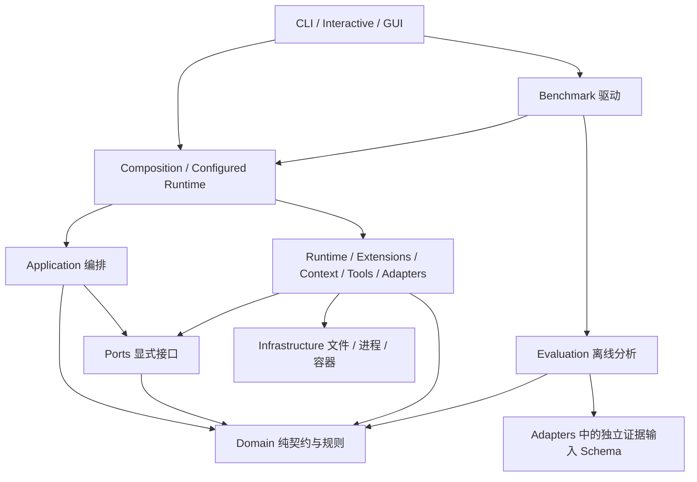

# Mini-dsh 项目结构与分层检查

本页描述当前工作树的目录职责、依赖规则与阅读路径。规则来自仓库
[AGENTS.md](../AGENTS.md) 与 [ADR 0001](adr/0001-runtime-architecture.md)，本次整理决策见
[ADR 0031](adr/0031-architecture-checks.md)。结构检查不替代功能、安全或机制收益验收。

## 1. 仓库目录

```text
mini-dsh/
├── src/minidsh/           可安装的运行时代码、交互入口与评测代码
├── tests/                pytest 契约、adapter 集成与端到端回归
├── examples/             Python 接线示例、人工 Skills、人工提示词模板
├── benchmarks/           固定任务、输入夹具、独立判据与参考解
├── scripts/              开发检查、冻结归档与评测驱动脚本
├── docs/                 设计说明、使用手册、ADR 与历史验收报告
│   ├── adr/              架构决策及其适用限制
│   └── results/          绑定版本的历史结果与派生结构报告
├── .github/workflows/    CI 工程门禁
├── AGENTS.md             仓库约束
├── pyproject.toml        包入口、依赖、格式、类型与测试配置
└── uv.lock               锁定依赖
```

`.minidsh/` 与 `benchmark-results/` 等是运行产物，不是新的源码层。原始 Trace、冻结
归档、任务夹具及既有结果不随目录整理搬动或重写。`examples/prompt_templates/` 是人工
资料，不是自动执行器或自动 Skill 提炼入口。

## 2. 源码职责图

这里采用依赖图，不把所有目录强行排成一条纵向链。`context/`、`tools/` 和
`adapters/` 都包含具体实现；`composition` 是知道这些实现并负责连接它们的位置。



图中实现组的箭头是职责概览，精确允许列表位于 `scripts/check_architecture.py`。

| 层 | 当前目录或文件 | 职责 | 允许的主要内部依赖 |
| --- | --- | --- | --- |
| 元数据 | `__init__.py` | 包版本 | 不依赖功能模块 |
| Domain | `domain/` | Message、事件、预算、状态、Skill/Memory 纯规则 | 自身 |
| Ports | `ports/` | Model、ToolExecutor、Context、Session、Memory 等接口 | Domain、自身 |
| Application | `application/` | Agent Loop、会话轮次、Context 组合与本地执行策略 | Domain、Ports、自身 |
| Runtime 核心 | `runtime/{events,services,plugins,hooks,catalog,approvals}.py` 及包入口 | 注册、生命周期、Hook、事件与审批交互 | Domain、Ports、自身 |
| Extensions | `runtime/skills/`、`runtime/memory*.py`、`runtime/verification.py` | Skills、Memory、Verification 的具体实现 | Domain、Ports、Runtime 核心、Tools、自身 |
| Context 实现 | `context/` | 历史策略、仓库检索、受控快照检索 | Domain、Ports、Infrastructure、自身 |
| Tools | `tools/` | 工具定义、注册、校验、授权与执行 | Domain、Ports、Runtime 核心、Infrastructure、自身 |
| Adapters | `adapters/` | 模型、文件、会话、凭据、Memory 持久化及输入解码 | Domain、Ports、Runtime 核心、Tools、Infrastructure、自身 |
| Infrastructure | `infrastructure/` | OS 路径、进程、锁、容器及受控 worker | Domain、自身 |
| Composition | `composition.py`、`configured_runtime.py`、`config.py`、`collaboration.py` | 配置解析、实现选择、接线与可选协作组装 | 上述运行时各层 |
| Evaluation | `evaluation/` | Trace 解析、独立判据计分、聚合和差值分析 | Domain、自身、精确共享的证据输入 Schema |
| Benchmark | `benchmark/` | 固定任务、隔离运行、产物捕获与评测驱动 | 运行时各层、Composition、Evaluation、自身 |
| Presentation | `cli.py`、`commands/`、`interactive.py`、`terminal.py`、`work_profile.py`、`__main__.py`、`gui/` | 参数、交互、展示及外层入口接线 | 可调用内层，内层不得反向依赖它；commands 不反向导入启动入口 |

所有层都可读取包元数据。Domain、Ports、Application 禁止第三方依赖，不能直接导入
adapter 或 OS 实现。Application 中的 `PurePosixPath` 只处理路径值，不执行文件 I/O。

`runtime/skills/__init__.py` 会导出具体工具，所以属于 Extensions。Runtime 核心不能
通过它引入 Tools。`tools/runtime.py → runtime/hooks.py` 与
`runtime/skills/service.py → tools/runtime.py` 不是文件级循环；这是按实际职责细分
Runtime 核心与 Extensions 的原因。

`evaluation → adapters.scoring_evidence` 是唯一精确放行的跨组输入依赖。这里放的是
独立验证 sidecar 的 Pydantic 解码模型，不包含模型调用、Memory 存储或计分算法。
Memory 读取器和离线计分使用同一模型，不再出现 `adapters → evaluation`。

## 3. 五项核心能力的接口与实现

| 能力 | 契约或接口 | 编排/实现 | 外部访问位置 |
| --- | --- | --- | --- |
| Agent Loop | `domain/models.py`、`ports/protocols.py` 的 AgentRunner/Factory | `application/agent_loop.py` | 通过注入的 Model、ToolExecutor、Journal 等 Ports |
| Tool Registry | `domain/models.py` 的工具契约、`ports/protocols.py` 的 ToolExecutor | `tools/runtime.py`，具体工具在 `tools/builtin.py` | `adapters/file_backend.py`、`infrastructure/` |
| Memory | `domain/memory.py`、`ports/memory.py` | `runtime/memory.py`、`memory_runner.py`、`memory_maintenance.py` | `adapters/memory.py`、`memory_evidence.py` |
| Context | `domain/models.py` 的 ContextView、`ports/protocols.py` | `application/context_assembly.py`、`context/strategies.py` | 生产检索通过受控工具准备快照 |
| Skills | `domain/skills.py`、`ports/skills.py` | `runtime/skills/service.py`、`tools.py`，ContextAssembly 读只读视图 | FileBackend 的 skill_scan / skill_read |

`application/session_journal.py` 是内存实现，`adapters/session_journal.py` 是磁盘实现；
同名不代表重复职责。Session 消息事实、运行 Trace、终态快照和项目 Memory 分开保存。

## 4. 两条组装路径与一次模型步骤

CLI 现在按下列职责组织，参数和 work 默认值均只有一份实现：

```text
cli.py                         main、错误处理、宿主依赖绑定、交互/运行接线和评测驱动
  ├── commands/arguments.py    命令语法、公共参数与模型参数
  ├── commands/configuration.py 参数翻译、配置来源优先级、config 命令
  ├── commands/models.py       模型/profile 选择、凭据回退与脱敏包装
  ├── commands/reports.py      report、trace replay / diff / metrics
  └── commands/work.py         work 默认值、提示词与配置来源优先级
```

commands 的实现不能反向导入 cli、__main__ 或 work_profile；包入口也受同一规则约束。
既有 `_build_parser`、`_work_config`、`_resolve`、`_model_arguments` 等调用名保留为
函数对象别名，main 与 task_options 的位置保持不变。模型选择通过 CLI 的小型绑定函数
接收实际 provider 工厂与凭据路径回调；commands 不回调 CLI。交互密钥输入/保存、
运行生命周期和评测驱动仍在入口接线，未在多处复制同一套逻辑。

`commands.models` 与 `adapters/profiles.py` 的职责不同：前者决定本次命令如何选择模型、
回退凭据并包装输出，后者拥有提供方配置及具体 adapter 构造。`commands/configuration.py`
只翻译命令行参数，底层 `config.py` 继续拥有字段校验与分层合并规则。

```text
CLI / 交互入口
  → resolve_config
  → build_configured_runtime
      → PluginCatalog / PluginManager / ServiceRegistry
      → 解析显式选择的实现
      → build_local_runtime

Python embedding
  → RuntimeOptions + RuntimeComponents
  → build_local_runtime

两条路径都得到 LocalRuntime
  → ConversationService 或 agent.run
  → AgentLoopFactory.create(AgentDependencies)
```

`plugin_runtime()` 也是显式托管组装入口，负责启动、替换时机与释放；它复用当前组装
能力，不是第二个 Agent Loop。`collaboration.py` 是可选外层控制器，不进入单 Agent 核心。
GUI 也是外层入口，不是 Domain 或 Application 的依赖。

```text
Journal 的原始历史
  → Context.prepare
      → 内部 ToolRuntime：发现 Skills、检索 Memory、准备仓库快照
      → 历史策略选择
      → ContextAssembly 加入指导与项目知识，记录来源
  → ModelRequest + 可见工具定义
  → 请求 Hook + 最终输入上限检查
  → Model adapter
  → ToolRuntime：Schema / 权限 / 审批 / 超时 / 执行
  → Observation 写回 Journal、事件进入 Trace
  → Continue 或完成决策
```

模型动作工具、Context 准备工具、操作者 Memory 维护工具使用不同执行集合。后两者
不能因为实现了同一个 ToolExecutor 就自动出现在模型的工具清单里。

## 5. 自动结构检查

```bash
uv run python scripts/check_architecture.py
uv run python scripts/check_architecture.py --json
uv run pytest tests/test_architecture.py
```

检查器只用标准库读取 `src/minidsh/**/*.py`，不导入或执行被检查源码。它检查：

1. 每个源码模块必须有明确层归属，新顶层模块不能静默落入任意层。
2. 显式绝对/相对导入必须遵守分层允许列表，函数内部及 TYPE_CHECKING 中的导入也检查。
3. Domain、Ports、Application 不得导入第三方包。
4. 文件级导入图不得存在多模块强连通组，同层循环也失败。
5. 输出模块数、去重内部导入数、分层清单、依赖边和按行数排序的维护热点。
6. commands（含包入口）不得反向导入 CLI、模块启动入口或完整开发启动器。

失败返回码为 1；报告携带文件与行号。CI 和 pytest 均接入。JSON 包含源码内容 hash
与检查器 hash，可核对报告对应的实现；不使用 HEAD 冒充当前工作树。

检查范围不包含动态 import、entry point 加载后的代码、第三方包内部、隐式 package
初始化展开、JS worker、真实文件/进程副作用或依赖注入后的对象关系。它检测显式导入
方向，不能证明沙箱安全、所有潜在运行时循环或没有 I/O。行数只是阅读与维护提示，
不是强制拆分阈值。

第一轮检查：105 个源码模块、379 条去重内部导入时发现 1 条反向依赖；提取证据 Schema
后为 106 个模块、380 条导入，分层违规 0、显式多模块循环 0。可再生成快照见
[首轮结构 JSON](results/architecture-2026-11-05.json)，对应当时源码与检查器，保持不变。
