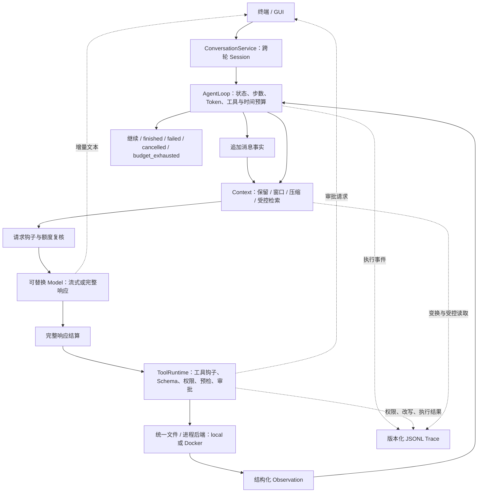

# 轻量 DeepSeek Harness：使用、扩展与验收

本项目以官方提交 `d743267388641bc76f17c45ce8b4c231aed1d32c` 为参照，
采用 Python 独立实现。本文记录实现范围，不表示 Cordis/npm 插件兼容或官方性能复现。

参照依据：[官方架构](https://github.com/deepseek-ai/deepseek-harness/blob/d743267388641bc76f17c45ce8b4c231aed1d32c/docs/architecture.md)、
[流式契约](https://github.com/deepseek-ai/deepseek-harness/blob/d743267388641bc76f17c45ce8b4c231aed1d32c/docs/subsystems/llm-streaming.md)、
[能力边界](https://github.com/deepseek-ai/deepseek-harness/blob/d743267388641bc76f17c45ce8b4c231aed1d32c/docs/capability-seams.md)。
对应下表中的事件、服务及 Session 机制；这些是功能对应关系，不是逐行移植。

## 架构与数据流

配置组合根启动插件、注入端口并管理资源释放。核心 Loop 依赖端口；
Model 不直接执行工具，文件和进程 adapter 共用明确选择的工作区与后端。



消息事实保存在稳定 Session，模型视图可重新生成；Trace 保存权限、钩子改写、
Context 变换和运行状态。原始事实与派生摘要分别保存，终态快照只用于兼容和展示。

## 日常使用

```bash
uv run mini-dsh work --test-command "uv run pytest"
uv run mini-dsh work --session SESSION_ID --test-command "uv run pytest"
uv run mini-dsh gui --model-profile deepseek
```

`work/chat/gui` 默认启用流式配置；支持该能力的 OpenAI-compatible 模型输出增量文本。
没有流式接口的模型保留完整响应路径，界面显示能力。工具参数完整结算后才允许执行。
`--no-stream` 关闭增量模式；一次性 `run` 和已有 Benchmark 默认非流式。
非流式旧 HTTP/MLX adapter 的取消仍受底层线程限制；不能将流式 HTTP 的验收推广过去。

写入和命令默认逐次审批，可允许本次、拒绝、记住本轮。记住写入匹配工具和真实路径，
命令匹配完整 argv/cwd；下一轮失效。审批不能覆盖缺失能力、deny 规则或路径限制。
非交互输入默认拒绝；离线自动化可显式选择 `--approval-mode configured`，沿用启动授权。
用户直接输入 `/test` 是对已配置固定测试命令的一次授权，仍经过参数、权限与命令策略。
只读子 Agent 委派不要求文件操作审批；既有多 Agent 模式尚不使用稳定 Session 或配置插件组合。

Ctrl+C/停止取消当前请求、待审批动作与进程。已经写入的文件保留；取消不是回滚。
缺少响应用量时记录 `unknown_usage_calls`，不按零消耗处理，也不继续当前 run 的模型调用。

`/sessions` 列出稳定会话和旧 run；`/session ID` 继续会话；`/resume RUN_ID` 恢复旧边界；
`/fork RUN_ID` 分叉已结束轮次。恢复不是最新轮次时创建分支，避免覆盖后续历史。
分叉只复制对话，不复制或回滚文件。GUI 的恢复对话框提供同样操作。
旧日志保持原样；新事实保存在 `.minidsh/conversations/ID/events.v1.jsonl`，使用平台单写者锁。
运行结果 JSON 是兼容快照，Context 和当前系统提示是从事实生成的视图。

## 配置插件与执行钩子

```toml
[minidsh]
plugins = [{ id = "my_context", config = { window = 16 } }]

[minidsh.services]
context = "my_context_service"
```

插件通过 Python entry point 组 `minidsh.plugins` 提供工厂：
`factory(config: dict[str, JsonValue]) -> Plugin`。插件声明稳定 ID、版本、服务与依赖。
内置模型、Context、事件、工具、权限、存储、Loop 和执行环境使用同一生命周期入口。
内置参数继续使用运行配置/profile；外部插件只加载明确选择的已安装分发包。

外部信任由 `--trust-plugin ID`、`MINIDSH_TRUSTED_PLUGINS` JSON 数组，或用户全局
`~/.config/minidsh/plugins.toml` 的 `trusted_plugins` 数组声明。工作区配置不能授予信任，
不接受任意 Python 文件路径，不自动安装。插件是可信宿主代码，不能用工具沙箱隔离恶意插件。

插件从服务注册表获取 `runtime_hooks`，调用 `HookRegistry.register()`，并用
`services.on_cleanup()` 管理返回的卸载回调。钩子按优先级、插件 ID、注册序号执行。
请求前允许修改消息和拒绝请求；工具前允许修改参数和拒绝调用。工具集合、权限和预算
仍由 Runtime 管理；修改后重新检查额度、Schema、权限、路径和命令，再进入审批。
成功执行后的工具钩子与结束前钩子只接收副本；异常记录结构化失败，保留已经发生的工具结果。
失败和拒绝结果通过事件/Trace 观察，当前不调用 `after_tool`。

选择 `services.environment` 时必须提供 `RuntimeEnvironment(runner, files)`，统一替换
文件和进程能力。单独配置远端 runner 被拒绝，避免命令在容器、文件仍在宿主的混用。
Docker 文件工具使用受控的标准库 worker，参数以 JSON/argv 传入，不插入 Shell。
容器默认 1 CPU、1 GiB、禁网、只读根、无新增权限；超时/取消后显式清理命名容器。
容器屏蔽整个 `.minidsh` 控制目录；大型输出的原始 artifact 由宿主保留供审计，
当前不能经容器文件工具回读这些宿主 artifact。
本地后端适用于信任的项目，不提供操作系统级隔离。

## Context

裁剪策略保留最新任务和明确标记的关键状态，并避免切开工具调用回合。
`summary` 仍是确定性的文本压缩，不是模型语义摘要。
Runtime 检索通过内部 `list_files/read_file` 工具读取有界快照，遵循相同授权和文件后端，
计入工具预算并记录 Trace。每步最多查看 80 个路径、读取 24 个片段，每片段 4000 字符；
这是轻量词面/AST 检索，不保证全仓库召回。直接构造旧 RepositoryRetriever 的 Python
辅助 API 保持兼容，它不代表 Runtime 的授权读取链。

## 验收与覆盖矩阵

先冻结源码、测试、协议与镜像哈希，再读取模型凭据。输出目录不可复用覆盖。

```bash
uv run python -m minidsh.benchmark.mini_dsh check --output benchmark-results/mini-dsh/v1
uv run python -m minidsh.benchmark.mini_dsh run --output benchmark-results/mini-dsh/v1 --credentials-file .env.deepseek
```

协议见 `benchmarks/mini_dsh/v1/protocol.json`。固定六类场景、每类两次，总名义额度
120000 Token；每场景跨轮累计 8000 Token、16 步、32 次工具、180 秒。
失败和在途超量保留；未知用量或总预算停止后，其余行保持未运行，不从十二行分母删除。
候选在独立临时验证容器测试，判据、参考代码和评分器不进入 Agent 工作区。
审批由确定性测试 adapter 提供，不算实际人工接受或介入。

| 能力 | 对应官方机制 / 简化 | 触发与预期 / 禁止行为 | 证据与状态 |
| --- | --- | --- | --- |
| 流式结算与取消 | `llm/stream`、`agent/assistant-stream`；完整响应兼容路径 | 拆分参数不提前执行；中断不提交完整回答；未知用量记录 | `test_harness_extensions` 通过；真实 repair 触发结算；连接取消为组件验收 |
| 审批 | `user-approval`；只收紧启动权限 | 忙时可批准；取消/超时/错 run 拒绝；记住范围不扩张 | `test_harness_safety`、审批事件通过；真实 denial 拒绝通过；人工体验未测 |
| 插件组合与卸载 | Cordis 可替换服务的 Python 子集 | 信任前不加载；缺依赖/环拒绝；资源逆序释放 | `test_plugin_catalog`、`test_runtime` 通过；真实 plugins_backend 钩子触发；Cordis 兼容未测 |
| 执行钩子 | `agent/request`、`tools/*` 的有序子集 | 改写后复校验；不能修改工具能力或真实结果 | `test_harness_extensions`、`test_harness_safety` 通过；真实请求改写触发 |
| Session 与分叉 | Session 事实、`deriveMessages()`、turn 边界分叉 | 不重复历史；第二写者拒绝；不回滚文件 | `test_conversations` 通过；真实 conversation/fork_resume 各 2/2；官方迁移链未测 |
| 执行环境 | `ctx.fs`、`ctx.subprocess`、`ctx.sandboxPolicy` 的 local/Docker 子集 | 同工作区读改测；越界/禁网拒绝；无遗留进程 | `test_file_backend` 和两版 `kernel.json` 通过；远端后端未测 |
| Context 保留与检索 | 事实投影与 Context 注入 | 保留关键状态；受控读取计预算；不覆盖事实 | `test_context_retention`、预算/取消测试通过；真实 plugins_backend 读取触发；召回收益未测 |
| 最终任务与恢复 | 独立验收层 | add 契约、固定 smoke、保护文件与场景规则 | 原模型队列 10/12；恢复分类修复后确定性 Docker 回归通过；最终版完整真实队列未重测 |

实际数字、版本差异及证据位置见[本轮验收报告](results/mini-dsh-runtime-2026-10-13.md)。
最终版 GUI 离线 Chrome 冒烟已检查增量展示、Patch 审批、会话列表与历史分叉，
相应交互和实际文件修改证据保存在 `final-20261013/gui_smoke_verification.json`；
停止按钮的原生浏览器路径和人工长期使用仍未测。
模型 case 的输入、预算、隔离和判据固定在协议及冻结的 `benchmark/mini_dsh.py` 快照；
组件 case 的故障注入和禁止行为固定在对应测试。每个运行保留绑定 run ID 的验证 sidecar。

每次验收以产物决定状态；未触发或未检查仍为未测。真实场景集中于一个微型 Python
修复任务的不同执行条件，不能推广到大型仓库、其他语言或通用成功率。
本轮不测 Cordis 插件兼容、热重载、远端沙箱、Session 格式迁移链、MLX 流式、
人工使用满意度，也不声称相对官方 DSH 的性能或机制收益。
